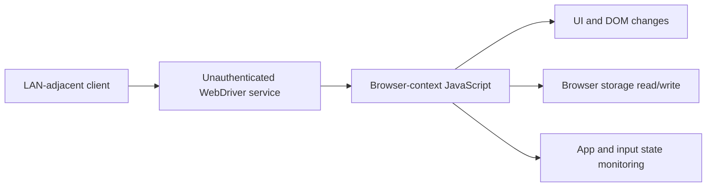

# CVE-2026-XXXXX — nauthenticated WebDriver Access via QA Build in Production Firmware in Google Cobalt

### Hisense VIDAA Smart TV · Security Research Advisory

**Yehia Elghaly** · Smart TV Security Research · Coordinated Disclosure

> [!IMPORTANT]
> **Draft / Private — CVE ID pending.** This advisory covers the tested Hisense 55A57EXVT firmware only. Publication timing must be coordinated with VulnCheck and the vendor.

**Affected service:** `Cobalt WebDriver :4444` &nbsp; | &nbsp; **Access:** Unauthenticated LAN &nbsp; | &nbsp; **Tested firmware:** `V0000.01.00a.P0220`

---

### Research highlights

| Browser execution | TV interface hijacking | Privacy & data exposure |
|:---:|:---:|:---:|
| **Unauthenticated JavaScript** | **Physical-screen overlay** | **Storage access and app-state monitoring** |

**[Root cause](#root-cause--attack-surface)** · **[Security impacts](#demonstrated-security-impacts)** · **[Mitigations](#remediation-recommendations)** · **[Disclosure](#disclosure--references)**

**Security Advisory** · **Improper Authentication** · **Network-Adjacent Attack** · **Coordinated Disclosure**

> **Disclosure status:** Draft for coordinated disclosure. Replace `CVE-2026-XXXXX` with the identifier assigned by VulnCheck. This advisory is based on testing of one device/firmware configuration; other versions have not been established as affected.

---

## Executive Summary

> **The finding:** An exposed, unauthenticated browser-automation service on a retail Smart TV allows a network-adjacent party to execute JavaScript in the TV interface. Demonstrated consequences include interface hijacking, browser-storage modification, and observation of application usage.

## Tested Environment

| Field | Details |
|---|---|
| Researcher | Yehia Elghaly |
| Vendor / platform | Hisense Smart TV / VIDAA OS; Google Cobalt browser component (component ownership to be confirmed) |
| Tested device | Hisense 55A57EXVT |
| Tested firmware | `V0000.01.00a.P0220` |
| Observed Cobalt build | `19.lts.5.205289-qa` |
| Affected interface | Cobalt WebDriver HTTP service, TCP port `4444` |
| Attack prerequisite | Network connectivity to the TV's exposed service; tested from the local network |
| Authentication | No credentials or user pairing required in the tested configuration |
| CVE | `CVE-2026-XXXXX` (placeholder) |
| Vendor remediation | Not established from supplied evidence |
| Public disclosure | Pending coordination with VulnCheck and vendor |

---

## Vulnerability Summary

A retail Hisense VIDAA Smart TV was observed exposing a Cobalt WebDriver automation service over the local network without authentication. An unauthenticated network-adjacent party could interact with an existing browser automation session and execute JavaScript in the TV's user-interface browser context.

The tested browser build reports the suffix `-qa`, consistent with a QA-oriented build. The research attributes the exposure to production deployment of an automation-enabled Cobalt build; the exact firmware configuration and causal mechanism require vendor confirmation.

## Root Cause & Attack Surface

The security boundary between an untrusted local-network client and the TV's privileged browser/UI automation context is not enforced by authentication or pairing on the exposed WebDriver interface. The research report states the service was bound to all interfaces; the supplied remote-access evidence independently establishes LAN reachability, not the full bind configuration.

**High-level attack path:** LAN reachability → unauthenticated WebDriver session access → JavaScript execution in the Cobalt UI context → access to browser storage and DOM → additional privacy, integrity, and availability impacts described below.

---

## Demonstrated Security Impacts

> [!NOTE]
> Screenshots are embedded immediately beneath the impacts they substantiate. Observations are separated from interpretations and unverified downstream effects.

The following outcomes were observed on the tested device. Screenshots are placed alongside the corresponding findings so that each claim can be evaluated with its evidence.

### 01 — Unauthenticated Browser Automation & JavaScript Execution

The supplied console output records successful HTTP responses from WebDriver service and session endpoints, followed by successful changes to page styles, text, and DOM elements. An existing session was accessible even when creating a new session returned an error; this does not invalidate the observed existing-session access.

*Figure 1 — Supplementary test console showing WebDriver interaction and browser-context behavior.*

### 02 — UI Hijacking & Full-Screen Overlay

The testing script altered page appearance and inserted a full-screen security-warning overlay. A photograph of the physical TV shows the injected warning rendered on the device. This demonstrates a plausible path to deceptive on-screen messaging and interference with normal UI operation.

*Figure 2 — Physical-device photograph of the injected warning. The phone number and error code shown are demonstration text, not a genuine Hisense advisory.*

*Figure 3 — Test output reporting successful UI modifications and DOM verification.*

### 03 — ACR-Related Browser Storage Read/Write

The ACR test output shows an `ACRSettingSwitch` localStorage value initially set to `1`, changed to `0`, verified in a separate readback, and restored to `1`. Other ACR-, advertising-, and recommendation-related keys were enumerated.

*Figure 4 — ACR-related localStorage values enumerated through the browser automation context; these values alone do not establish telemetry transmission or consent history.*

**Scope limitation:** The evidence confirms browser-storage read/write capability; it does **not** by itself establish that the underlying ACR telemetry engine stopped transmitting, that the user was never shown a consent prompt, or that an ACR privacy preference was persistently changed across reboot/cloud synchronization.

*Figure 5 — Baseline ACR-related keys and successful write/readback.*

*Figure 6 — Independent state readback and restoration to the original value.*

### 04 — Viewing-Activity & Device-State Monitoring

Researcher-produced monitoring output shows transitions among Netflix, YouTube, and Live TV/HDMI-related UI routes and changes in the volume value. These observations establish visibility into application/UI state and user interaction timing without credentials.

**Scope limitation:** Application identifiers and UI routes do not necessarily prove access to the exact video title, program content, or complete viewing history. The observed data is sufficient to infer application usage patterns and certain interactions.

*Figure 7 — Dashboard showing detected app/input state, volume, and UI route.*

*Figure 8 — Console monitoring of application-route changes and volume updates.*

### 05 — Application Data Extraction & Reported Exfiltration

The supplied research report describes extraction of browser localStorage values and receipt of an outbound HTTP POST at researcher-controlled infrastructure from the TV's public IP. The accompanying extraction/exfiltration scripts implement this test path.

**Evidence qualification:** Receiver-side HTTP logs or screenshots showing the received request and sanitized payload were not among the clearly identified supporting images for this advisory. Therefore, external delivery is recorded here as **researcher-reported** pending attachment of independent receiving-end evidence. Do not publish extracted secrets, tokens, private keys, MAC addresses, or identifiable user information.

### 06 — Exposed Native Bridge (Further Validation Required)

The research report describes access to the `window.hisense` native bridge, including file and system-related APIs. The presence of exposed bridge methods should be documented separately from any claim that unrestricted operating-system file access or command execution has been demonstrated. Specific outcomes require matching successful execution logs and appropriate evidence.

## Attack-Path Overview

The diagram illustrates the observed browser-level trust-boundary failure, not unrestricted operating-system execution.

## Reproduction Summary (Non-Weaponized)

On the tested firmware, a LAN-adjacent researcher established that the exposed WebDriver service was reachable without credentials, obtained access to a browser session, and verified JavaScript execution with benign DOM modifications. The researcher then demonstrated browser-storage read/write and monitored changes in TV UI state. Detailed reproduction scripts and sensitive output are retained separately for coordinated private validation.

## Remediation Recommendations

- Remove or disable remote browser automation/debug services in production firmware unless explicitly required.
- If diagnostic access is necessary, bind it to a restricted management interface and enforce strong authentication, authorization, and user-approved pairing.
- Ensure JavaScript executing through diagnostic contexts cannot access sensitive TV UI state or native bridges beyond strictly necessary privileges.
- Audit the shipping firmware and build pipeline for QA/debug functionality and verify fixes across affected hardware/firmware variants.

---

## Disclosure & References

- **CVE ID:** `CVE-2026-XXXXX` — pending replacement with VulnCheck-assigned identifier.
- **Coordinated disclosure:** VulnCheck / vendor; dates to be confirmed.
- **Conference research:** *Pwned on the Couch: Hacking Smart TVs into Surveillance Devices* — Black Hat MEA 2026.
- **Researcher:** Yehia Elghaly.

> **Publication note:** Keep this repository private until the agreed disclosure date. This advisory is intended as the eventual public reference; full reproduction scripts, raw dumps, credentials, and receiver-side unredacted logs belong in a separate private evidence repository.
