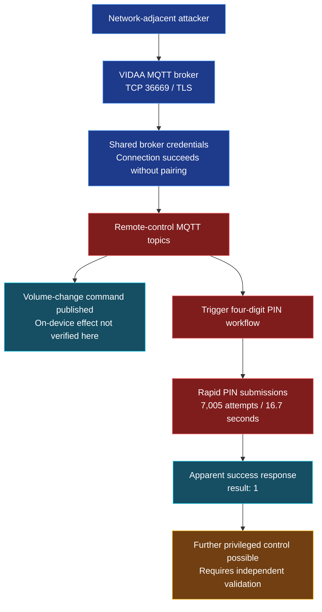

# Hisense VIDAA Smart TV - MQTT Remote-Control Authentication Bypass and PIN Brute-Force Vulnerabilities

**Vendor:** Hisense  
**Product:** VIDAA Smart TV — model `55A57EXVT`  
**Tested firmware:** `V0000.01.00a.P0220`  
**Affected component:** VIDAA MQTT remote-control broker, TCP `36669` (TLS)  
**Attack prerequisite:** Network access to the television's MQTT broker  

**Researcher:** Yehia Elghaly · **Status:** Coordinated disclosure

## Description

The tested Hisense VIDAA Smart TV exposes an MQTT remote-control broker on TCP port `36669` that accepts a shared, product-level credential pair without requiring an initial on-screen device-pairing step to establish the broker connection.

The broker exposes messaging topics associated with television functions, including volume control, navigation, application launching, source management, and PIN-based remote-controller authorization. The research identified weaknesses in the separation between broker authentication and device authorization, together with rapid processing of PIN guesses.

**The strongest directly visible findings are successful MQTT broker access using the shared credentials (hisenseservice/multimqttservice), publication of a volume-change command without pairing, and a rapid series of PIN submissions that received an apparent success response.** 

## Demonstrated Security Impacts

### 01 - MQTT Broker Access Without Device Pairing

I have connected to the television's MQTT broker over TLS using the shared credentials configured in the test client. The connection was established **without first completing the TV's on-screen PIN pairing process**.

**Attacker impact:** A network-adjacent party who knows these shared credentials can establish an MQTT session and interact with exposed remote-control topics. Broker access alone should not be confused with authorization for every TV command; the latter must be verified per action.

### 02 - Remote Volume-Control Command Without Pairing

After establishing the MQTT connection, i have published a `platform_service/changevolume` command requesting volume level `10`. The command was sent successfully without pairing.

**Attacker impact:** If the command is processed by the television, an unauthorized network client can interfere with the viewer's audio experience by changing volume remotely. The uploaded terminal screenshot proves publication of the command, **not a confirmed on-device volume change**; no successful volume readback is shown in that run.

*Figure 1 — MQTT connection using shared credentials and a volume-change command issued without pairing.*

### 03 - High-Rate PIN Guessing and Apparent Authentication Success

The test client triggered the TV's PIN workflow and submitted **7,005 PIN guesses in approximately 16.7 seconds**. The captured responses included repeated `Wrong authNum!!` messages and an apparent successful authentication response (`result: 1`). The client associated that success with candidate PIN `6954`.

**Attacker impact:** An attacker with broker access can be able to undermine the four-digit pairing mechanism through high-rate online guessing if the server does not enforce effective attempt limits or lockouts. A successful pairing expose additional remote-control functionality.

*Figure 2 - High-rate PIN attempts against the TV's remote-control authentication workflow.*

Figure 3 - Test summary reporting 7,005 attempts, an apparent accepted PIN

### 04 - Unauthorized Remote-Control Functions

The exposed MQTT command surface includes actions for remote key events, app launch, input selection, and device-state queries. These are relevant to the potential consequences of insufficient authorization.

**Potential attacker impact, subject to per-action verification:** Interruption of viewing, unwanted navigation or application launches, changes to the active input, and disclosure of TV state.

## Attack-Path Overview

## Root Cause

The findings indicate two distinct authorization concerns:

1. **Shared broker credentials:** MQTT connection authentication is not equivalent to unique, user-approved device pairing. A client can establish a broker session using shared credentials.
2. **Insufficient PIN-attempt controls:** The captured run processed thousands of PIN submissions in seconds and returned an apparent success response, raising concern about online PIN guessing and the effectiveness of rate limiting.

The precise authorization policy for each MQTT action and the persistence of pairing across restarts require further validation.

TLS Certificate Verification Not Enforced: Although the VIDAA MQTT broker communicates over TLS on TCP port 36669, the smart TV successfully established a connection with certificate verification disabled (CERT_NONE and tls_insecure_set(True)). This means the smart TV did not authenticate the server's identity, leaving that client connection vulnerable to man-in-the-middle attacks and server impersonation. TLS encryption alone does not guarantee endpoint authenticity when certificate verification is disabled.

## Evidence and Scope

| Evidence | Observation |
|---|---|
| MQTT connection | Successful TLS broker connection using configured shared credentials |
| Volume command | `changevolume 10` published; physical effect not confirmed in screenshot |
| PIN submissions | 7,005 attempts in 16.7 seconds |
| PIN responses | Repeated incorrect-code responses plus an apparent success response |
| Post-pairing verification | Volume readback returned `None`; privileged access not independently established |

The original research notes describe additional tests, including default-PIN behavior and control from other LAN hosts. Those claims should be accompanied by their own logs or physical-device evidence before being presented as independently verified in this README.

## Recommended Remediation

- Replace shared, product-wide broker credentials with unique per-device credentials or authenticated device identities.
- Require completed user-approved pairing **before** allowing sensitive remote-control actions.
- Apply server-side PIN attempt limits, delays, expiration, and lockouts; invalidate outstanding challenges after repeated failures.
- Bind pairing approval to the requesting client and enforce authorization separately for each sensitive MQTT topic.
- Restrict MQTT broker access to trusted network segments and review broker ACLs.
- Use properly validated TLS certificates for client connections.
