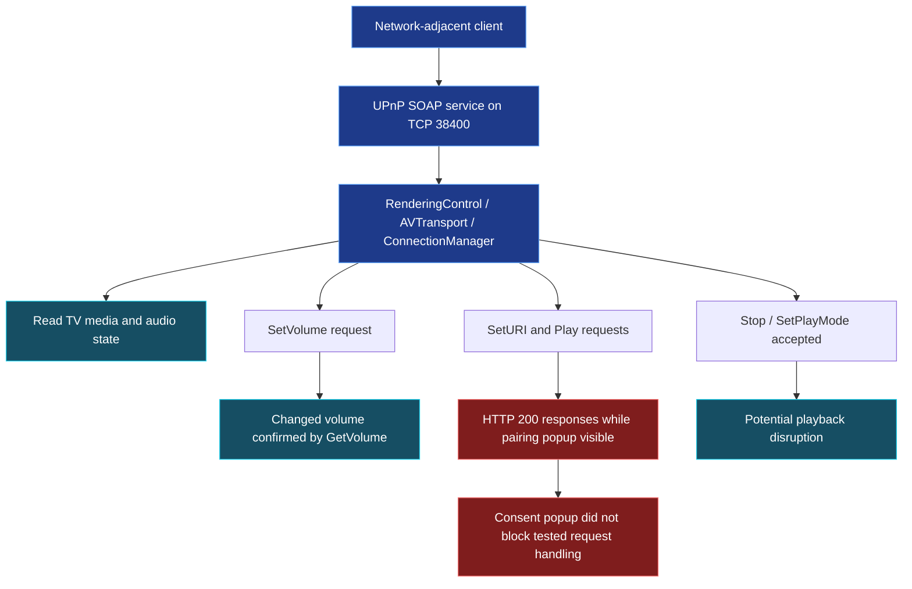

# Hisense VIDAA Smart TV - Unauthorized UPnP Control and Consent-Popup Enforcement Weakness

**Vendor:** Hisense  
**Affected device tested:** Hisense 55A57EXVT  
**Firmware tested:** `V0000.01.00a.P0220`  
**Affected services:** UPnP/DLNA RenderingControl, AVTransport, and ConnectionManager on TCP `38400`  
**Attack prerequisite:** LAN access to the UPnP control service; behavior was tested after device pairing and during a visible pairing popup.

**Researcher:** Yehia Elghaly · **Status:** Coordinated disclosure

## Description

The Hisense VIDAA Smart TV exposes UPnP SOAP control operations that permit a network client to read media and playback state and modify TV behavior without a separate authorization prompt for each operation. In controlled testing, i have successfully changed the television's volume using `RenderingControl:SetVolume` and verified the resulting value with `GetVolume`. The AVTransport interface also accepted playback-related commands, including `Stop` and `SetPlayMode`.

A separate timing test showed that **six consecutive `SetAVTransportURI`/`Play` request pairs returned HTTP 200 while a DLNA pairing popup was visible on the television**. `GetVolume` also returned HTTP 200 during that window. These observations indicate that the visible popup did not block SOAP command handling in the tested sequence. HTTP success alone does not prove that all requested media actually played.

## Demonstrated Security Impact

### 01 - Unauthorized Remote Volume Manipulation

An attacker able to issue accepted UPnP control requests can change the television's audio level without using the physical remote. The researcher changed volume from **6 to 10**, then verified the new value through an independent `GetVolume` readback. In a broader range test, requested settings **0, 1, 5, 10, 20, 30, 50, 70, and 80** all matched the values read back from the television.

**Impact:** An unauthorized network client can interfere with the user's viewing experience by remotely raising or lowering the TV's volume. Repeated commands could cause ongoing disruption, although sustained override of the physical remote was not independently demonstrated in the supplied screenshots.

*Figure 1 - The command-surface test confirmed a change from volume 6 to 10, alongside successful read-only SOAP operations.*

*Figure 2 - Volume values 0–80 matched their readback. Requests for 90 and 100 returned 89 and 94 respectively, so exact control at the top of the range was not established.*

### 02 - Playback Interference and Media-State Disclosure

The tested SOAP interface returned successful responses for `GetTransportInfo`, `GetMediaInfo`, `GetPositionInfo`, `GetVolume`, `GetMute`, `GetProtocolInfo`, and `GetCurrentConnectionIDs`. It also accepted `SetPlayMode` and `Stop` requests. A `Pause` request returned HTTP 500 when no active stream was available; this is not evidence of an authorization denial.

**Impact:** A network client can obtain browser-independent media transport information, including playback state, current media URI/metadata, playback position, and current audio settings. Accepted playback-control commands can also interfere with media sessions; the precise user-visible effect depends on whether an active stream is present.

## Attack-Path Overview

## Root Cause

The observed behavior is consistent with insufficient authorization enforcement at the UPnP SOAP command boundary. Commands affecting the TV's playback and volume are accepted without an individual user-confirmation step, and the observed pairing popup does not prevent request processing during the tested timing window.

The exact device-pairing policy and the persistence of any prior trust relationship require vendor confirmation.

## Evidence and Validation Notes

- **Volume change:** Verified by `SetVolume` followed by `GetVolume` readback (6 → 10).
- **Volume range:** Nine requested levels from 0 through 80 matched; 90 and 100 did not match exactly.
- **Command surface:** Multiple information-gathering commands returned HTTP 200; `Stop` and `SetPlayMode` were accepted.

## Remediation Recommendations

- Enforce device authorization **before** processing any UPnP state-changing SOAP command.
- Ensure pending pairing/consent dialogs block command execution until explicit approval.
- Require authorization checks for sensitive read operations as appropriate, and apply authorization consistently across RenderingControl, AVTransport, and ConnectionManager.
- Provide a way to revoke previously trusted controllers and restrict access to local trusted networks.
- Add regression tests for commands issued before, during, and after the pairing dialog.
