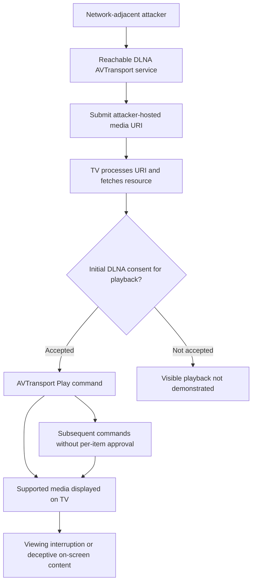

# CVE-2026-XXXXX — Unauthorized Content Injection via DLNA AVTransport on Hisense VIDAA Smart TV

**Security Research Advisory** · **Yehia Elghaly** · **Coordinated Disclosure**

> [!IMPORTANT]
> **Draft — CVE identifier pending.** Findings apply to the tested device and firmware. Coordinate publication with VulnCheck and the vendor.

| Field | Tested configuration |
|---|---|
| Vendor / platform | Hisense / VIDAA OS |
| Device | Hisense 55A57EXVT |
| Firmware | `V0000.01.00a.P0220` |
| Affected service | UPnP/DLNA AVTransport SOAP, TCP `38400` |
| Attack prerequisite | Network access to the AVTransport service; one-time acceptance of a DLNA consent popup for on-screen playback in the demonstrated workflow |
| CVE | `CVE-2026-XXXXX` (placeholder) |

## Executive Summary

The tested Hisense VIDAA Smart TV accepts media URLs supplied by a network client through the DLNA AVTransport `SetAVTransportURI` interface. Following the one-time on-screen DLNA authorization in the tested workflow, an attacker on the local network can cause the TV to fetch and display attacker-hosted media **without further confirmation for each command**.

The researcher demonstrated HTTP requests from the TV to a controlled content server and photographed attacker-controlled content rendered on the physical television. The primary security impact is **unauthorized control of displayed media**, which can interrupt normal viewing and support deceptive or misleading on-screen content.

## Root Cause & Attack Surface

The AVTransport SOAP service processes client-supplied media URIs without sufficiently restricting the origin of media or enforcing authorization for every subsequent playback action. The research notes that URL fetching can begin before the user responds to the initial consent popup; however, **successful visible playback without that initial consent was not established**.

## Demonstrated Security Impacts

### 01 — Remote Injection of Attacker-Controlled Content onto the TV Screen

A network-adjacent client can direct the television to retrieve a media resource from an attacker-controlled HTTP server and, following the initial DLNA approval, render supported content on the physical screen. The accompanying physical-device evidence shows a researcher-generated content-injection display and a media playback screen.

**Attacker impact:** An unauthorized network client could replace or interrupt what the viewer is watching with arbitrary *supported media*, including deceptive notices or impersonated security messages embedded as images or video. This enables on-screen social engineering and interference with normal television use.

*Figure 1 — Physical television displaying researcher-generated content-injection proof of concept.*

*Figure 2 — Physical television displaying test video content via the media playback interface.*

### 02 — Untrusted Media Fetching and Playback Control

The test console records successful `SetAVTransportURI`, `Play`, and `Stop` operations (HTTP 200) and confirms that the television fetched resources from the researcher's HTTP server. The log records requests for an H.264 MP4, a JPEG image, and an HTML document.

**Attacker impact:** A network client able to invoke the AVTransport commands can make the television request externally hosted content and initiate or stop playback. This could disrupt active viewing or expose the TV to attacker-selected media resources.

*Figure 3 — SOAP command results and server-side fetch logs for video, image, and HTML test resources.*

**Important distinction:** An HTTP 200 response to a SOAP command or a successful HTTP fetch does **not** prove that the media was decoded or displayed. The test script reports that H.264 MP4 and HTML were fetched but not rendered as playable content in that run. The physical-device photographs separately demonstrate supported content appearing on-screen. The evidence does not establish arbitrary HTML/JavaScript execution, filesystem disclosure, or playback without initial DLNA consent.

### 03 — Persistent Control After Initial DLNA Approval

The supplied advisory reports that once the device's DLNA approval prompt is accepted, later media commands can execute without an additional user prompt for each resource.

**Attacker impact:** A previously approved local-network client may repeatedly change or interrupt the displayed media without renewed confirmation, creating an ongoing integrity and availability risk until that client's access is revoked or otherwise blocked.

## Attack-Path Overview

**Scope:** The diagram distinguishes the observed media fetch from the separate user-consent requirement for demonstrated screen playback.

## Remediation Recommendations

- Require explicit, revocable authorization for remote media-control clients, with appropriate user visibility.
- Validate and constrain AVTransport URI schemes and destinations; restrict access to local files and internal services.
- Do not fetch or process untrusted media URLs before the required authorization decision.
- Provide users with controls to review and revoke paired DLNA devices; consider confirmation for disruptive playback changes.
- Verify fixes across affected firmware versions and TV models.

## Disclosure

**Researcher:** Yehia Elghaly  
**CVE:** `CVE-2026-XXXXX` — awaiting assignment  
**Status:** Coordinated disclosure with VulnCheck and the vendor; dates to be confirmed.

> The screenshots show controlled proof-of-concept content. They do not establish that the vendor issued the displayed messages.
