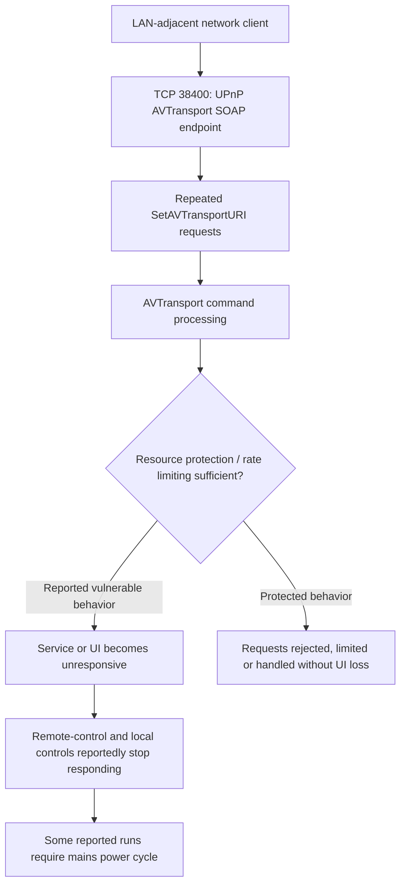

# Hisense VIDAA Smart TV — UPnP AVTransport SOAP Flooding Denial of Service

> **Security research advisory | Availability impact | LAN-adjacent attack surface**

## Executive summary

A denial-of-service condition was reported during controlled testing of the UPnP/DLNA AVTransport SOAP service exposed by a Hisense VIDAA Smart TV on TCP port **38400**. According to the researcher's original advisory, sustained unauthenticated `SetAVTransportURI` requests caused the television interface to freeze, with the remote control and physical power control becoming unresponsive. Some reported runs required disconnecting mains power to recover.

**Evidence qualification:** The supplied original advisory reports these hard-freeze observations. The separately supplied screenshot is from an **outbound callback test**, not the SOAP flooding test: it shows playback latency spikes but **zero observed HTTP callbacks**. It does not independently establish a hard freeze, SSRF, or outbound fetch.

## Tested environment

| Field | Value |
|---|---|
| Vendor / platform | Hisense / VIDAA |
| Device model | 55A57EXVT |
| Tested firmware | V0000.01.00a.P0220 |
| Affected component | UPnP/DLNA AVTransport SOAP service |
| Network port | TCP 38400 |
| Relevant SOAP action | `urn:schemas-upnp-org:service:AVTransport:1#SetAVTransportURI` |
| Attack position | A host able to reach the television's LAN-facing service |
| CVE identifier | Not provided; do not assign one without confirmation |

## 01 — Vulnerability description

The AVTransport service accepts network-originated SOAP commands that influence media playback. The researcher's advisory describes insufficient request throttling or resource protection for repeated `SetAVTransportURI` operations. During the reported flooding tests, processing of these commands allegedly overwhelmed the service or dependent TV software, resulting in loss of normal interactive operation.

The exact internal failure mechanism—such as a backed-up request queue or blocked handler thread—**has not been independently verified** by device traces or firmware instrumentation. The observable issue is the reported device-level loss of availability under sustained request load.

## 02 — Attack-path diagram

*The diagram illustrates the reported attack path, not a verified internal implementation trace.*

## 03 — Security impact

### 3.1 — Denial of television availability

**Reported impact: loss of interactive control of the physical television.** The original advisory states that repeated unauthenticated SOAP commands caused the display to freeze on the current content within approximately **3–10 seconds**. This is more serious than an individual media-playback error because the reported symptom affected the television's broader user interface.

### 3.2 — Loss of normal recovery controls

The advisory reports that the remote control and physical power button stopped responding during some freeze events. It further reports that some runs required disconnecting mains power. If independently reproduced, this would demonstrate a high-disruption availability failure that cannot be resolved through ordinary on-screen navigation.

### 3.3 — Network exposure and operational risk

The reported attack requires network reachability to the UPnP service, not physical access to the TV. Shared or poorly segmented networks could increase exposure. However, impact on additional models, firmware versions, or multiple TVs simultaneously **has not been demonstrated by the supplied evidence**.

### 3.4 — What the evidence does *not* establish

This finding does not demonstrate operating-system command execution, data theft, or persistent compromise. The screenshot below does **not** prove an HTTP callback or SSRF. Latency spikes alone are insufficient to prove a denial-of-service condition.

## 04 — Research evidence

### 4.1 — Original flooding-test observations (researcher advisory)

The supplied advisory records these observations:

- Initial SOAP requests reportedly received HTTP `200` responses.
- Sustained requests reportedly froze the displayed content within **3–10 seconds**.
- Remote-control and physical-button responsiveness were reportedly lost.
- Some runs reportedly required a mains power cycle to restore operation.

These are **researcher-reported observations**; the current attachments do not include a video, console trace, or timestamped packet capture of the actual hard-freeze test.

### 4.2 — Separate outbound callback test (supporting context only)

The supplied screenshot shows an AVTransport callback probe using several HTTP and non-HTTP URI types. It records **no HTTP callbacks received**, along with a reported playback latency spike of **8,000 ms** for one case. This suggests an anomalous response time during that test, but does not prove that the TV fetched a remote resource or became unresponsive.

*Figure 1 — Separate callback experiment. No external HTTP fetch was confirmed. Do not use this image as standalone evidence of a SOAP flooding hard freeze.*

## 05 — Reproduction methodology (high level)

In an isolated, authorized laboratory environment, establish baseline TV responsiveness and AVTransport SOAP response times, then compare them against a controlled, bounded series of `SetAVTransportURI` requests. Record whether the on-screen UI, remote control, and physical controls remain responsive. Preserve request/response timestamps, device video, packet captures, and recovery steps. Stop immediately if responsiveness degrades.

For public disclosure, use a **bounded and non-destructive validation procedure** rather than an unbounded flooding loop. No live target addresses or unrestricted DoS commands are included in this README.

## 06 — Root cause assessment

**Hypothesis:** Inadequate request-rate controls and/or failure to isolate AVTransport processing from UI-critical resources may permit repeated commands to exhaust or block shared execution capacity.

**Confidence:** The original advisory attributes the issue to missing throttling and an overloaded request queue. The provided materials do not contain instrumentation proving that particular implementation mechanism. Vendor investigation is required to confirm the root cause.

## 07 — Recommended remediation

1. Require appropriate authorization or pairing for state-changing AVTransport commands.
2. Apply per-client and global request-rate limits, queue bounds, and backpressure.
3. Ensure malformed or excessive SOAP requests cannot block UI-critical threads.
4. Add command timeouts and safe cancellation for stalled media operations.
5. Restrict UPnP control interfaces to trusted network segments where possible.
6. Regression-test recovery of remote-control and power-management responsiveness during network request bursts.

**Temporary mitigation:** Isolate the TV from untrusted LAN clients and filter access to TCP 38400 where network controls permit, while preserving required legitimate features.

## 08 — Disclosure and validation status

| Item | Status |
|---|---|
| Original researcher advisory | Provided |
| Hard-freeze behavior | Reported in advisory; independent visual/packet evidence not attached here |
| Callback test | Completed; no HTTP callbacks observed |
| Vendor acknowledgement / patch | Not established in supplied materials |
| CVE assignment | Not supplied |

**Research scope:** Hisense 55A57EXVT, VIDAA firmware V0000.01.00a.P0220. Findings should not be generalized to all Hisense or VIDAA products without additional testing.

---

*Responsible disclosure: This document is intended to support coordinated vulnerability reporting and reproducible defensive validation.*
