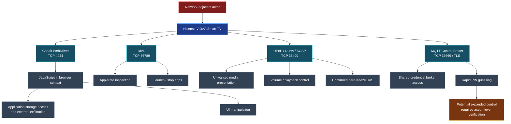

[README-Hisense-Smart-TV-Security-Research.md](https://github.com/user-attachments/files/33917572/README-Hisense-Smart-TV-Security-Research.md)

# 📺 Hisense Smart TV Security Research

### Six security findings across VIDAA's network-facing control and media services

**Independent vulnerability research and vendor notification**

**One television. Multiple exposed services. A shared security boundary: the local network.**

[Research Overview](#-research-at-a-glance) · [Potential Exposure](#-potentially-affected-devices--exposure-scope) · [Six Findings](#-the-six-findings) · [Attack Surface](#-attack-surface-overview) · [Disclosure Timeline](#-vendor-notification-timeline)

---

## 🔎 Research at a Glance

This repository documents **six security findings** identified during independent security testing of a **Hisense VIDAA Smart TV**. The research examines how network-accessible automation, discovery, media playback, remote-control, and messaging interfaces may allow a network-adjacent actor to interact with the television without adequate authentication or authorization.

The observed consequences span **browser-context JavaScript execution, application-data exposure, on-screen content manipulation, remote app control, denial of service, and TV control-plane weaknesses**.

| Research detail | Tested environment |
|:--|:--|
| **Manufacturer / platform** | Hisense / VIDAA |
| **Tested firmware** | `V0000.01.00a.P0220` |
| **Browser component** | Google Cobalt `19.lts.5.205289-qa` |
| **Attacker position** | Network-adjacent, with reachability to the relevant exposed service |
| **Findings documented** | **6** |

> **Scope:** These findings were validated on a Hisense VIDAA television running firmware `V0000.01.00a.P0220`. Whether the same firmware or vulnerable software components are deployed on other television models, production years, or firmware releases has not yet been established. The verified test does not establish the total number of affected devices.

## 🌍 Potentially Affected Devices & Exposure Scope

The six findings were **validated on a Hisense VIDAA television running firmware `V0000.01.00a.P0220`**. A firmware version or vulnerable software component can potentially appear across multiple TV models and product generations. However, **distribution of this exact firmware across additional models has not been verified**, and neither firmware overlap nor shared VIDAA branding alone establishes that a device is vulnerable. The wider VIDAA installed base provides context for possible exposure, **not a count of vulnerable devices**.

### Confirmed scope versus potential wider exposure

| Category | Evidence and interpretation |
|:--|:--|
| **Verified firmware in the tested environment** | `V0000.01.00a.P0220`; the six findings were demonstrated on a device running this version. |
| **Potential exposure across TV models** | Other Hisense TVs **could** share the same firmware or affected network-facing components. This remains a research hypothesis pending firmware inventories and reproduction on additional devices. |
| **Potential exposure across production years** | TV sets sold in different years may remain in service and receive updates. A TV's purchase year alone cannot establish whether it runs an affected firmware version or software component. |
| **VIDAA ecosystem size** | VIDAA/Hisense publicly reported **more than 30 million connected devices worldwide** in 2025. An Adkemix presentation estimated approximately **40 million active VIDAA devices in Q2 2025**. Neither figure is a count of vulnerable devices. |
| **Confirmed additional firmware/device combinations** | **None independently established by this research.** |
| **Total potentially affected devices or users** | **Unknown; no reliable vulnerability prevalence estimate is available.** |

**Firmware identification matters:** The complete firmware version `V0000.01.00a.P0220` is the tested identifier. A shared update suffix, similar hardware, or use of VIDAA does **not** prove that another television runs the same firmware or has the same vulnerabilities.

### Why older televisions matter to the exposure window

Televisions are often retained for much longer than smartphones. This means that **past sales cohorts may continue to contribute to today's installed base**, including models sold years before a vulnerability becomes public.

- **Circana (30 March 2023):** In its U.S. TV ownership research, the average age of a TV **when replaced was 6.6 years**; **25.5% of installed TVs were at least seven years old**. These are U.S. market figures, not Hisense-specific or global estimates. [Source: Circana](https://www.circana.com/post/new-circana-report-reveals-first-signs-of-an-upcoming-tv-purchase-refresh-cycle).
- **NielsenIQ (2024):** Larger electronics such as televisions are typically replaced every **5–10 years**, supporting the possibility of extended device use. [Source: NielsenIQ](https://nielseniq.com/global/en/insights/commentary/2024/the-macroeconomic-impacts-of-shifting-consumer-mindsets/).
- **Hisense/VIDAA (2025):** Hisense explicitly promoted **up to eight years of VIDAA software updates**, including security enhancements, application updates, and performance improvements, as a way to extend useful TV life without hardware replacement. VIDAA also stated that its platform connected **over 30 million devices worldwide**. [Source: Hisense UK, 31 January 2025](https://uk.hisense.com/news-and-blogs/VIDAA_8_year_update_policy) · [Source: VIDAA](https://www.vidaa.com/).

**Illustrative lifecycle:** A TV purchased in **2019** could still be in use in **2026**, seven years later. If that specific model received an update in **2025**, the updated software could still be deployed on an older device. **This is a lifecycle example, not verification that any particular TV purchased in 2019 received updates through 2025.** Similarly, Hisense's **“up to eight years”** statement does **not** establish that every model, region, or previously sold television qualifies, and continued updates may also remediate security issues.

**Security implication:** A vulnerability in a long-lived, network-accessible TV component could remain relevant across multiple years of installed devices **if** the same vulnerable component or firmware is present and the affected service is reachable. That is a plausible *exposure mechanism*, not proof of cross-model exploitation. A household may also retain a replaced television as a secondary set or transfer it to another owner, but no quantitative adjustment for such reuse is made here.

### How many televisions could potentially be affected?

**There is currently no defensible numeric estimate for the six CVEs.** The key missing variables are the number of active devices running affected firmware/components, the affected model-year distribution, whether the vulnerable services are enabled or accessible, and whether a relevant fix has been deployed.

For perspective **only**, the table below applies *arbitrarily chosen percentages* to a **30 million-device illustrative VIDAA platform baseline** (based on VIDAA's published **30M+** figure). It shows the arithmetic that would follow **if** a given share were independently established as affected. **None of the percentages represents a measured or predicted vulnerable share.**

| Hypothetical share of a 30M-device baseline | Illustrative device count | Evidence status |
|:--:|--:|:--|
| **0.1%** | **30,000** | Hypothetical only — not established |
| **1%** | **300,000** | Hypothetical only — not established |
| **5%** | **1,500,000** | Hypothetical only — not established |

> **Interpretation warning:** These figures are **not estimates, findings, minimums, maximums, or claims** about affected Hisense televisions. The 30M+ VIDAA figure spans the broader platform, including multiple brands and product generations, and is not a count of installations of `V0000.01.00a.P0220`. Actual exposure could be far lower or otherwise different. **Affected TVs and affected users are also different metrics**: one TV can serve multiple people, and one person can own several TVs.

A defensible prevalence estimate would require (1) model-by-model firmware and component mapping, (2) reproducibility testing across versions, (3) active installation or sales-and-survival figures, and (4) evidence of patch adoption or remaining exposure. Until then, the scientifically accurate affected-device and affected-user counts remain **unknown**.

**Additional market-size source:** [Adkemix / HbbTV, *Global Overview of Smart TV Operating Systems* (Q2 2025)](https://www.hbbtv.org/wp-content/uploads/2025/11/Damien-de-FOUCAULT-Adkemix_TV-OS-Panorama_Nov-2025_presentation_.pdf).

## 🧭 The Six Findings

| # | Vulnerability / exposed service | CVE ID | Security impact | Evidence summary |
|:--:|:--|:--:|:--|:--|
| **01** | [01 - Cobalt WebDriver Exposure](Unauthenticated%20WebDriver%20Access%20via%20QA%20Build%20in%20Production%20Firmware%20in%20Google%20Cobalt.md)· TCP `4444` | <strong>CVE&#8288;-&#8288;2026&#8288;-&#8288;123993</strong> | Browser-context JavaScript execution, application storage disclosure, external HTTP data exfiltration, UI manipulation | Existing WebDriver session accessed; internal storage extracted; outbound webhook POST observed |
| **02** | [02 - DIAL Application Control](Unauthenticated%20App%20State%20Surveillance%20and%20Remote%20App%20Control%20via%20DIAL.md)· TCP `56789` | <strong>CVE&#8288;-&#8288;2026&#8288;-&#8288;123994</strong> | Unauthorized app-state inspection, application launch, and termination | DIAL state queried; app launch returned HTTP `201`; app termination returned HTTP `200` |
| **03** | [03 - DLNA Content Injection](Unauthorized%20Content%20Injection%20via%20DLNA%20AVTransport%20on%20Hisense%20VIDAA%20Smart%20TV.md)· TCP `38400` | <strong>CVE&#8288;-&#8288;2026&#8288;-&#8288;123995</strong> | Unwanted on-screen media and content presentation; playback interference | Media fetches logged and test content displayed on physical TV; consent behavior varies by workflow |
| **04** | [04 - Single-Request Denial of Service](Unauthenticated%20Single-Request%20Denial%20of%20Service%20via%20UPnP%20AVTransport%20on%20Hisense%20VIDAA.md) · TCP 38400· | <strong>CVE&#8288;-&#8288;2026&#8288;-&#8288;123997</strong> | Complete TV unresponsiveness requiring a physical power-cycle, as reported in the freeze test | I confirmed a complete TV freeze with no response to the remote or physical power button; restoring operation required disconnecting and reconnecting mains power |
| **05** | [05 - UPnP Authorization Weakness](Hisense%20VIDAA%20Smart%20TV%20-%20Unauthorized%20UPnP%20Control%20and%20Consent-Popup%20Enforcement%20Weakness.md)· TCP `38400` | <strong>CVE&#8288;-&#8288;2026&#8288;-&#8288;123996</strong> | Unauthorized override of remote-control functions, including volume modification; playback-state exposure and command processing during a consent popup | Volume changes verified by readback; SOAP commands returned success while popup was visible |
| **06** | [06 - MQTT Authentication Weaknesses](Hisense%20VIDAA%20Smart%20TV%20-%20MQTT%20Remote-Control%20Authentication%20Bypass%20and%20PIN%20Brute-Force%20Vulnerabilities.md)· TCP `36669` / TLS | <strong>CVE&#8288;-&#8288;2026&#8288;-&#8288;123998</strong> | Broker access using shared credentials; volume-control command submission; rapid PIN guessing and apparent pairing success | MQTT connection established; `7,005` PIN attempts in `16.7 s`; apparent success response observed |

**Read the individual advisory files in this repository for the full technical descriptions, reproduction evidence, screenshots, and scope limitations.** The file list appears above this README on the repository's **Code** tab.

### What makes these findings significant?

- **Confidentiality:** The WebDriver finding includes demonstrated extraction of JavaScript-accessible TV data and receipt of that data at an external HTTP endpoint.
- **Integrity:** Network-accessible control interfaces can alter the viewer's experience through application control, browser UI changes, media presentation, or volume adjustment.
- **Availability:** A single unauthenticated UPnP AVTransport request rendered the television completely unresponsive until I physically disconnected and reconnected its power supply.
- **Authentication boundaries:** Several interfaces rely on absent, shared, incomplete, or inconsistently enforced authorization mechanisms. Their requirements differ; not every finding is a zero-interaction exploit.

## 🕸️ Attack Surface Overview

> **Diagram note:** This is a summary of distinct findings, not a single chained exploit. The prerequisites and degree of demonstrated control differ across services.

## 🧪 Evidence and Validation

Each individual finding is documented separately to preserve its specific attack prerequisites, observed behavior, and evidence. Supporting material includes, where applicable:

- Network service responses and protocol-level test output.
- On-device photographs of the television displaying researcher-controlled content.
- Browser storage extraction and external webhook receipt.
- Command execution and device-state verification logs.
- Screenshots of authentication and consent behavior.

## 📬 Vendor Notification Timeline

| Date | Event |
|:--|:--|
| **27 April 2026** | Initial vulnerability report sent to **Hisense**. |
| **2 May 2026** | Follow-up reminder sent to the vendor. |
| **30 October 2026** | **No vendor response received more than six months after my initial report.** |

**Vendor status:** As of **30 October 2026**, I have received no acknowledgement or response from Hisense since my initial notification on 27 April 2026.

This timeline documents my communications with Hisense. I have not received confirmation of the findings, a severity assessment, or remediation information from the vendor. I will update the advisories if a response becomes available.

## 🛡️ Security Recommendations

At a high level, vendors and integrators should consider:

1. **Disable production exposure of debugging and automation services** or restrict them to authenticated, explicitly enabled development environments.
2. **Require device-specific authentication and authorization** for remote-control, media, and application-management commands.
3. **Enforce meaningful user consent** before sensitive actions and ensure consent prompts actually block command execution until approval.
4. **Rate-limit pairing attempts**, bind pairing approval to a requesting client, and enforce lockouts or challenge expiration.
5. **Harden UPnP/DLNA processing** against untrusted requests and resource-exhaustion conditions.
6. **Reduce unnecessary network exposure**, use broker topic-level access controls, and protect communication with correctly validated TLS identities.

For owners and network administrators, **isolating Smart TVs from untrusted LAN clients** can reduce exposure while vendor fixes are unavailable.

## ⚖️ Responsible Research and Usage

This repository is published for defensive security research, vulnerability analysis, and responsible public disclosure following vendor notification. All testing was performed against a device under my control. Do not test systems without authorization.

**No universal exploitability claim is made:** The documented results apply to the tested configuration unless additional affected versions are established.

---

### 📺 Smart TVs are computers on your network — their control interfaces deserve the same security scrutiny.

**Hisense Smart TV Security Research** · Independent Security Research · Vendor Notified

