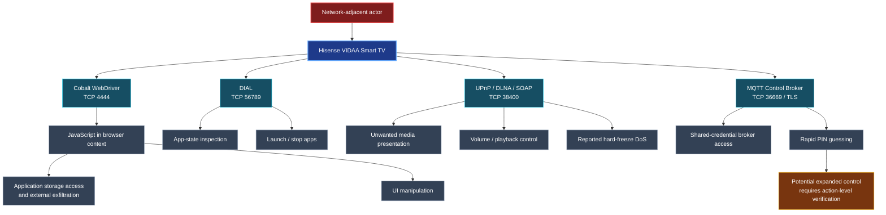

# 📺 Hisense Smart TV Security Research

### Six security findings across VIDAA's network-facing control and media services

**A coordinated vulnerability disclosure research project**

**One television. Multiple exposed services. A shared security boundary: the local network.**

[Research Overview](#-research-at-a-glance) · [Six Findings](#-the-six-findings) · [Attack Surface](#-attack-surface-overview) · [Disclosure Timeline](#-coordinated-disclosure-timeline)

---

## 🔎 Research at a Glance

This repository documents **six security findings** identified during independent security testing of a **Hisense VIDAA Smart TV**. The research examines how network-accessible automation, discovery, media playback, remote-control, and messaging interfaces may allow a network-adjacent actor to interact with the television without adequate authentication or authorization.

The observed consequences span **browser-context JavaScript execution, application-data exposure, on-screen content manipulation, remote app control, denial of service, and TV control-plane weaknesses**.

| Research detail | Tested environment |
|:--|:--|
| **Manufacturer / platform** | Hisense / VIDAA |
| **Tested model** | `55A57EXVT` |
| **Tested firmware** | `V0000.01.00a.P0220` |
| **Browser component** | Google Cobalt `19.lts.5.205289-qa` |
| **Attacker position** | Network-adjacent, with reachability to the relevant exposed service |
| **Findings documented** | **6** |
| **CVE identifiers** | Add assigned IDs to individual advisories when confirmed |

> **Scope:** Results are based on the specific device and firmware tested. They should not be assumed to affect every Hisense television or VIDAA release without additional verification.

## 🧭 The Six Findings

| # | Vulnerability / exposed service | Security impact | Evidence summary |
|:--:|:--|:--|:--|
| **01** | **Unauthenticated Cobalt WebDriver** · TCP `4444` | Browser-context JavaScript execution, application storage disclosure, external HTTP data exfiltration, UI manipulation | Existing WebDriver session accessed; internal storage extracted; outbound webhook POST observed |
| **02** | **DIAL Application Control** · TCP `56789` | Unauthorized app-state inspection, application launch, and termination | DIAL state queried; app launch returned HTTP `201`; app termination returned HTTP `200` |
| **03** | **DLNA / AVTransport Content Injection** · TCP `38400` | Unwanted on-screen media and content presentation; playback interference | Media fetches logged and test content displayed on physical TV; consent behavior varies by workflow |
| **04** | **UPnP / SOAP Denial of Service** · TCP `38400` | Complete TV unresponsiveness requiring a physical power-cycle, as reported in the freeze test | Researcher reports hard freeze without notification or popup; separate callback experiment did not independently reproduce the freeze |
| **05** | **UPnP RenderingControl Authorization Weakness** · TCP `38400` | Remote volume modification, playback-state exposure, and command processing during a consent popup | Volume changes verified by readback; SOAP commands returned success while popup was visible |
| **06** | **VIDAA MQTT Remote-Control and Pairing Weaknesses** · TCP `36669` / TLS | Broker access using shared credentials; volume-control command submission; rapid PIN guessing and apparent pairing success | MQTT connection established; `7,005` PIN attempts in `16.7 s`; apparent success response observed |

**Read the individual advisory files in this repository for the full technical descriptions, reproduction evidence, screenshots, and scope limitations.** The file list appears above this README on the repository's **Code** tab.

### What makes these findings significant?

- **Confidentiality:** The WebDriver finding includes demonstrated extraction of JavaScript-accessible TV data and receipt of that data at an external HTTP endpoint.
- **Integrity:** Network-accessible control interfaces can alter the viewer's experience through application control, browser UI changes, media presentation, or volume adjustment.
- **Availability:** The reported SOAP-flooding test rendered the television unresponsive until power was physically disconnected and restored.
- **Authentication boundaries:** Several interfaces rely on absent, shared, incomplete, or inconsistently enforced authorization mechanisms. Their requirements differ; not every finding is a zero-interaction exploit.

## 🕸️ Attack Surface Overview

> **Diagram note:** This is a summary of distinct findings, not a single chained exploit. The prerequisites and degree of demonstrated control differ across services.

## 🧪 Evidence and Validation

Each individual finding is documented separately to preserve its specific attack prerequisites, observed behavior, and evidence. Supporting material includes, where applicable:

- Network service responses and protocol-level test output.
- On-device photographs of the television displaying researcher-controlled content.
- Browser storage extraction and external webhook receipt.
- Command execution and device-state verification logs.
- Screenshots of authentication and consent behavior.

**Interpretation matters:** A successful protocol response does not always prove a corresponding on-screen effect. Similarly, a received HTTP request is evidence of a network fetch, not necessarily execution of arbitrary code. The individual advisories distinguish demonstrated results from further security implications.

## 📬 Coordinated Disclosure Timeline

| Date | Event |
|:--|:--|
| **27 April 2026** | Initial vulnerability report sent to **Hisense**. |
| **2 May 2026** | Follow-up reminder sent to the vendor. |
| **25 October 2026** | **No vendor response received**, according to the researcher's disclosure record. |

**Vendor status:** Awaiting acknowledgement or response as of **25 October 2026**.

This timeline records communications reported by the researcher; it does not imply that Hisense has confirmed the findings, accepted the reported severity, or issued a fix. Any subsequent vendor response or remediation information will be reflected in the corresponding advisories.

## 🛡️ Security Recommendations

At a high level, vendors and integrators should consider:

1. **Disable production exposure of debugging and automation services** or restrict them to authenticated, explicitly enabled development environments.
2. **Require device-specific authentication and authorization** for remote-control, media, and application-management commands.
3. **Enforce meaningful user consent** before sensitive actions and ensure consent prompts actually block command execution until approval.
4. **Rate-limit pairing attempts**, bind pairing approval to a requesting client, and enforce lockouts or challenge expiration.
5. **Harden UPnP/DLNA processing** against untrusted requests and resource-exhaustion conditions.
6. **Reduce unnecessary network exposure**, use broker topic-level access controls, and protect communication with correctly validated TLS identities.

For owners and network administrators, **isolating Smart TVs from untrusted LAN clients** can reduce exposure while vendor fixes are unavailable.

## ⚖️ Responsible Research and Usage

This repository is published for defensive security research, vulnerability analysis, and coordinated disclosure. Testing was performed against a device under the researcher's control. Do not test systems without authorization.

**No universal exploitability claim is made:** The documented results apply to the tested configuration unless additional affected versions are established.

---

### 📺 Smart TVs are computers on your network — their control interfaces deserve the same security scrutiny.

**Hisense Smart TV Security Research** · Independent Security Research · Coordinated Disclosure

