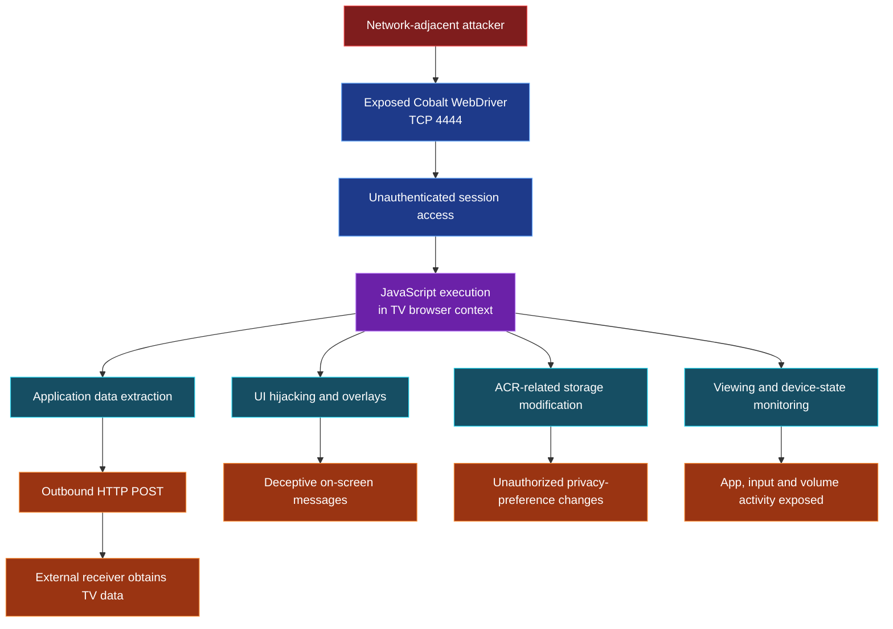

# CVE-2026-XXXXX — Unauthenticated Cobalt WebDriver Access on Hisense VIDAA Smart TV

**Security advisory | Yehia Elghaly | Coordinated disclosure**

> [!IMPORTANT]
> **CVE ID pending.** This document describes a vulnerability verified on one Hisense 55A57EXVT running firmware `V0000.01.00a.P0220`. Keep private until coordinated publication.

| Affected device | Exposed interface | Access required |
|---|---|---|
| Hisense 55A57EXVT (VIDAA) | Cobalt WebDriver, TCP `4444` | Network access to TV; **no authentication or pairing** |

**Observed browser build:** `19.lts.5.205289-qa`

## Vulnerability Overview

The tested retail television exposes a Google Cobalt WebDriver automation interface to the local network without authentication. A network-adjacent attacker can interact with an existing browser session and execute JavaScript in the TV's VIDAA user-interface context. The exposed automation capability permits unauthorized access to browser storage and UI state, modification of on-screen content, and transmission of accessible data to an external endpoint.

**Root cause:** A browser automation/debugging interface is reachable by untrusted network clients without an access-control boundary. The `-qa` build suffix is observable; the exact firmware packaging cause requires vendor confirmation.

## Demonstrated Security Impacts

### 01 — Unauthenticated Remote JavaScript Execution Leading to Sensitive Data Disclosure and External Exfiltration

**Attacker capability:** Any party able to reach the exposed WebDriver service can execute JavaScript inside the TV's active browser/UI session **without credentials, pairing, or approval from the TV owner**. Unlike harmless automation, this grants the remote party access to the application data and functions available to that browser context.

**Observed result:** WebDriver session access and JavaScript execution were confirmed. The researcher subsequently retrieved internal `localStorage` data and demonstrated its outbound transmission to a controlled HTTP receiver. This is **browser-context JavaScript execution**, not a demonstrated operating-system shell or unrestricted native code execution.

*Figure 1 — Unauthenticated WebDriver access and JavaScript execution in the television's UI context.*

### 02 — TV Interface Hijacking and Deceptive Full-Screen Overlays

**Attacker capability:** A network-adjacent attacker can replace or obscure the visible TV interface with attacker-controlled text and full-screen content. This could be used to **display fake security alerts, impersonate vendor warnings, mislead the viewer into following instructions, or disrupt normal TV use**. A deceptive overlay could facilitate social engineering; actual credential theft was not demonstrated.

**Observed result:** The researcher injected a full-screen warning into the running UI, and the physical television displayed it. This demonstrates direct unauthorized control over content shown to the viewer.

*Figure 2 — Full-screen warning injected by the researcher, not a genuine Hisense security notice.*

### 03 — Unauthorized Modification of ACR and Advertising-Related Settings

**Attacker capability:** An attacker can **read and modify browser-stored privacy and advertising preferences** without the owner's consent. This creates an integrity risk: settings displayed or relied upon by the TV application may be tampered with, potentially misleading users about their privacy choices or altering application behavior where those settings are consumed.

**Observed result:** The researcher changed `ACRSettingSwitch` from `1` to `0`, confirmed the modified value through an independent readback, and restored the original value. ACR, personalized-advertising, and recommendation-related keys were also accessible.

**Evidence boundary:** Changing a `localStorage` flag does not by itself prove that ACR telemetry stopped or started, that a consent notice was bypassed, or that the change survived a restart.

*Figure 3 — Unauthorized modification and verification of an ACR-related browser-storage value.*

### 04 — Viewing-Activity and Device-State Monitoring

**Attacker capability:** A remote attacker can observe browser-accessible app and input state, potentially **tracking when a household switches between streaming apps, Live TV, and HDMI inputs**, as well as changes in volume and UI navigation. Repeated polling can reveal usage patterns and periods of activity without accessing the television physically.

**Observed result:** Monitoring output recorded changes among Netflix, YouTube, launcher and Live TV/HDMI-related routes, along with volume-state changes.

**Evidence boundary:** App names and routes do not establish the exact movie, episode, broadcast program, or complete viewing history.

*Figure 4 — Repeated observations of app/UI transitions and device-state changes.*

### 05 — Sensitive Application Data Extraction and Confirmed External Exfiltration

**Attacker capability:** The unauthenticated JavaScript execution can be used to **collect internal TV configuration and identifiers and send them beyond the local network**. This changes the exposure from passive access to an actionable confidentiality compromise.

**Observed result:** The researcher extracted **42–43 `localStorage` entries** across test runs, including ACR and advertising preferences, location-setting data, HDMI state, MAC-address-formatted keys, and advertising-service version/signature metadata. A controlled Webhook.site receiver recorded an approximately **2.4 KB HTTP POST** containing structured device information and `localStorage` values.

**Attack sequence:** **LAN access → unauthenticated WebDriver session → browser-context JavaScript → application data collection → external HTTP POST.**

*Figure 5 — Browser-accessible application storage retrieved through WebDriver.*

*Figure 6 — Researcher-controlled receiver showing an HTTP POST with TV device metadata.*

*Figure 7 — Received JSON containing extracted application storage values.*

**Evidence boundary:** Advertising-service signature fields are not independently verified as reusable authentication credentials. No claim is made here of Wi-Fi password theft, unrestricted filesystem access, or OS-level command execution.

## Attack-Path Overview

The following diagram summarizes the demonstrated attack path and its security consequences on the tested Smart TV.

**Attack prerequisite:** Network access to the exposed WebDriver service; no authentication or pairing was required during testing.

**Scope:** The demonstrated execution occurs in the Cobalt browser context. Unrestricted operating-system command execution was not established.

## Remediation

- **Disable WebDriver and QA/debug automation interfaces in production firmware** unless strictly required.
- If diagnostic access is required, restrict its network exposure and enforce strong authentication, authorization, and user-approved pairing.
- Separate automation contexts from sensitive UI state and native TV interfaces; audit production build/release controls.

## Disclosure

**Researcher:** Yehia Elghaly  
**CVE:** `CVE-2026-XXXXX` (awaiting assignment)  
**Status:** Coordinated disclosure with VulnCheck and the vendor  
**Research presentation:** *Pwned on the Couch: Hacking Smart TVs into Surveillance Devices* — Black Hat MEA 2026

> [!CAUTION]
> Redact MAC addresses, receiver URLs, signature values, and identifiable device/user information before public release. Keep full exploit scripts and raw sensitive evidence outside the eventual public repository.
