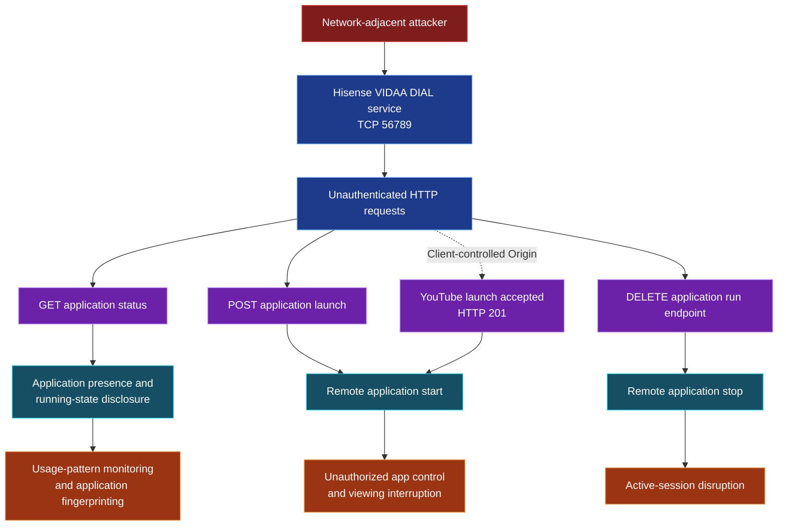

# CVE-2026-XXXXX — Unauthenticated App State Surveillance and Remote App Control via DIAL

### Hisense VIDAA Smart TV · Security Advisory

**Researcher:** Yehia Elghaly · **Status:** Coordinated disclosure — CVE identifier pending

> [!IMPORTANT]
> **Draft / Private.** Replace `CVE-2026-XXXXX` with the assigned identifier before publication. Findings are based on the tested device and firmware; other models and versions have not been verified.

| Field | Tested configuration |
|---|---|
| Vendor / platform | Hisense / VIDAA OS |
| Device | Hisense 55A57EXVT |
| Firmware | `V0000.01.00a.P0220` |
| Affected service | DIAL (Discovery and Launch), TCP `56789` |
| Attack vector | Network-adjacent HTTP access to the exposed service |
| Authentication | No credentials or device pairing required in the tested configuration |
| CVE | `CVE-2026-XXXXX` — pending |

## Vulnerability Overview

The tested Hisense VIDAA Smart TV exposes a DIAL application-control service on TCP port **56789** that responds to application status and control requests without authentication or user-approved pairing. A network-adjacent attacker who can reach this port can determine the state of supported applications, terminate running applications, and launch installed applications without the television owner's authorization.

The research also demonstrated that an application-launch request for YouTube could be accepted when the HTTP client supplied `Origin: https://www.youtube.com`. Because a non-browser client can set this header, the observed check did not provide reliable authentication for the tested request.

**Security consequence:** Unauthorized disclosure of application usage state and unauthorized control of the television's streaming applications, including interruption of active sessions.

## Demonstrated Security Impacts

### 01 — Unauthenticated Application-State Surveillance

An unauthenticated network client can query the DIAL service for application state. The tested console retrieved the status of **Netflix**, **YouTube**, and **AmazonInstantVideo** without credentials. The responses exposed states such as `running` and `stopped`, as well as the `allowStop` property when available.

**What an attacker can do:** Repeatedly query the service to determine when supported applications are launched or stopped, infer patterns of TV usage, and identify which queried applications are available. Differences between successful application responses and `404` responses may support application-presence fingerprinting.

**Impact:** Loss of privacy concerning application usage and household viewing activity. Application presence alone does **not** prove an active paid subscription, identify the account holder, or disclose the exact program being watched.

*Figure 1 — DIAL status queries exposing application state without authentication. YouTube returned HTTP 403 in this capture, so its state was not confirmed by that response.*

### 02 — Unauthorized Remote Application Launch

Testing showed that an unauthenticated HTTP `POST` request to the DIAL application endpoint returned **HTTP 201** and a launch location for **AmazonInstantVideo**. A subsequent status query reported the application as `running`.

**What an attacker can do:** Remotely start a supported installed application without using the TV remote or obtaining the owner's approval. Depending on the application's behavior, this can interrupt the current viewing experience, change the active on-screen application, and repeatedly disrupt normal television use.

**Impact:** Unauthorized control over the TV's application lifecycle and interference with the viewer's current session.

*Figure 2 — Unauthenticated application launch returning HTTP 201, followed by a `running` state.*

### 03 — Unauthorized Application Termination and Viewing Disruption

The researcher sent an unauthenticated `DELETE` request to the DIAL run endpoint for **Netflix**. The service returned **HTTP 200**, and a subsequent status refresh showed Netflix as `stopped`.

**What an attacker can do:** Terminate an active streaming application remotely. Repeated termination requests could cause persistent viewing interruptions and prevent normal use of an affected application while the attacker maintains network access.

**Impact:** Availability loss and unauthorized interruption of active streaming sessions. The evidence demonstrates application-level disruption, not a television-wide denial of service or permanent damage.

*Figure 3 — HTTP 200 response to an unauthenticated Netflix termination request, followed by verification that the application was stopped.*

### 04 — Client-Controlled Origin Header Accepted for YouTube Launch

The supplied test code and console output show a YouTube launch request that included the client-supplied header `Origin: https://www.youtube.com`. The displayed request returned **HTTP 201**.

**What an attacker can do:** Set the expected Origin value in a custom HTTP client and submit a launch request without proving that it originated from an authorized YouTube application or a paired device.

**Impact:** The observed Origin-based restriction is insufficient as an authentication mechanism for this tested request. The result supports unauthorized launch behavior; it does not establish access to YouTube account credentials or bypass of YouTube's own login controls.

*Evidence: The terminal capture in Figure 3 also shows the client-supplied YouTube Origin header and the HTTP 201 response.*

## Attack-Path Overview

The diagram summarizes the observed entry point and its distinct confidentiality, integrity, and availability consequences.

**Attack prerequisite:** Reachability to the TV's DIAL service from the local network. No authentication or pairing was required during the demonstrated tests.

## Root Cause

The DIAL service did not enforce an authentication or user-approval boundary for the tested application status, launch, and termination operations. For the YouTube launch request, accepting a caller-controlled HTTP `Origin` value did not establish the caller's identity or authorization.

## Remediation Recommendations

- Require authenticated, explicitly authorized device pairing before exposing application status or control functions to other network devices.
- Restrict DIAL access to trusted interfaces and callers, and disable unnecessary remote-control functionality where possible.
- Do not treat the HTTP `Origin` header alone as proof of an authorized client.
- Apply authorization consistently to application-state queries, launches, and termination requests.
- Validate remediation across supported TV models, firmware releases, and DIAL-enabled applications.

## Disclosure

**Researcher:** Yehia Elghaly  
**CVE:** `CVE-2026-XXXXX` (placeholder; assignment pending)  
**Tested device:** Hisense 55A57EXVT / firmware `V0000.01.00a.P0220`  
**Coordination:** VulnCheck and vendor; publication date to be confirmed.

> **Publication note:** Keep this advisory private until the coordinated disclosure date. The screenshots are research evidence; redact internal IP addresses and other identifying information if required before publishing.
