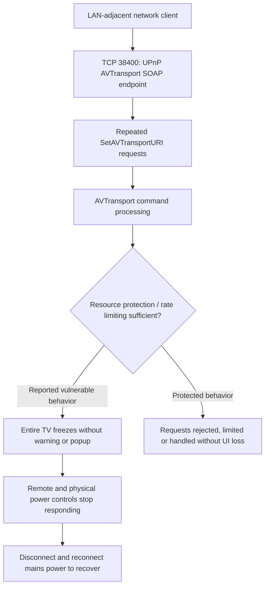

# Hisense VIDAA Smart TV - UPnP AVTransport SOAP Flooding Denial of Service

> **Security research advisory | Availability impact | LAN-adjacent attack surface**

## Executive summary

A LAN-adjacent attacker can cause a **complete denial of service** on the tested Hisense VIDAA Smart TV by running a script that repeatedly sends unauthenticated `SetAVTransportURI` SOAP requests to the UPnP/DLNA AVTransport service on **TCP 38400**. During my flooding test, the TV **completely froze**, including the displayed content and normal device controls. **No notification, warning, confirmation dialog, or pairing popup appeared** to alert the user or request approval. The television did not recover through ordinary controls; restoring operation **required physically disconnecting power and reconnecting it to restart the TV**.

**Evidence qualification:** I physically confirmed a complete TV freeze requiring mains power cycling after running the attached AVTransport callback probe as well as during my reported flooding test. The console screenshot records the callback probe's requests and response delays; it does not independently capture the TV's physical condition or establish the internal cause of the freeze.

## Tested environment

| Field | Value |
|---|---|
| Vendor / platform | Hisense / VIDAA |
| Device model | 55A57EXVT |
| Tested firmware | V0000.01.00a.P0220 |
| Affected component | UPnP/DLNA AVTransport SOAP service |
| Network port | TCP 38400 |
| Relevant SOAP action | `urn:schemas-upnp-org:service:AVTransport:1#SetAVTransportURI` |
| Attack position | A host able to reach the television's LAN-facing service |

## 01 — Vulnerability description

The Hisense VIDAA Smart TV exposes a UPnP/DLNA AVTransport SOAP service on **TCP port 38400** that accepts `SetAVTransportURI` requests from a network-reachable client without authentication. When I executed a script issuing these requests repeatedly, **the entire television became unresponsive**, rather than merely stopping a media stream or crashing one application.

The display froze on its current content, and **both the remote control and the television's physical power control stopped responding**. The TV presented **no warning, notification, consent request, or pairing popup** before or during the attack. The device remained frozen until power was physically disconnected and reconnected, forcing a hard restart.

The observed failure is a **device-wide availability loss triggered remotely over the local network**. Insufficient request throttling or isolation of AVTransport processing is a plausible cause, but the precise internal failure mechanism has not been verified through firmware traces.

## 02 - Attack-path diagram



*The diagram illustrates the reported attack path, not a verified internal implementation trace.*

## 03 - Security impact

### 3.1 - Complete remote denial of service

**Impact: Total loss of TV availability.** Once the flooding script was executed against the tested device, the television **froze completely**, leaving the screen stuck on its current content. The user could no longer operate the TV normally, switch applications or inputs, or continue viewing content. The TV became entirely unresponsive, including to the remote and physical power button, and required a mains power cycle to recover.

**What an attacker can do:** A network-adjacent attacker who can reach TCP port 38400 can intentionally disrupt the television's operation by sending repeated unauthenticated SOAP requests, without needing credentials or physical access.

### 3.2 - No user notification or consent prompt

The TV displayed **no notification, warning, pairing request, or consent popup** when the attack began. The user therefore received no on-screen opportunity to approve, reject, or interrupt the incoming commands before the device froze.

**Security consequence:** The attack can begin silently from the local network and cause a sudden loss of availability without an on-screen indication of the cause.

### 3.3 - Forced physical power-cycle recovery

During the freeze, **the remote control and the TV's physical power button were unresponsive**. The television could not be recovered using normal controls. **I had to unplug the TV from mains power and reconnect it to restart the device.**

**Security consequence:** The attack causes a disruptive device-wide failure requiring physical intervention, rather than a temporary playback interruption or an application restart.

### 3.4 - Scope and limitations

The observed effect concerns **availability**. The supplied materials do not demonstrate data theft, operating-system command execution, or persistence. Testing on other Hisense models or firmware versions has not been established. The callback screenshot alone does not show the TV's physical freeze; I confirmed that effect by direct observation.

## 04 - Proof of concept and research evidence

### 4.1 - Illustrative SOAP request (non-flooding)

The following **single-request example** illustrates the UPnP AVTransport SOAP request format used in my testing. It is not the complete test script, does not include a flooding loop, and is **not intended to reproduce the device freeze**. Run only against equipment you own or are authorized to test.

```python
import requests

# Replace this placeholder with an authorized lab device address.
endpoint = "http://TV_IP:38400/upnp/control/mingusavtr"
service = "urn:schemas-upnp-org:service:AVTransport:1"

soap_body = f'''<?xml version="1.0" encoding="utf-8"?>
<s:Envelope xmlns:s="http://schemas.xmlsoap.org/soap/envelope/">
  <s:Body>
    <u:Play xmlns:u="{service}">
      <InstanceID>0</InstanceID>
      <Speed>1</Speed>
    </u:Play>
  </s:Body>
</s:Envelope>'''

response = requests.post(
    endpoint,
    data=soap_body.encode("utf-8"),
    headers={
        "Content-Type": 'text/xml; charset="utf-8"',
        "SOAPAction": f'"{service}#Play"',
    },
    timeout=3,
)
print("HTTP status:", response.status_code)
```

**Evidence boundary:** A successful HTTP response to this illustrative request would show that the endpoint processed a SOAP command; it would **not** demonstrate a denial of service. My device-wide freeze observations are documented separately below.

### 4.2 - Original flooding-test observations (researcher advisory)

In my original advisory, I recorded the following observations:

- Initial SOAP requests reportedly received HTTP `200` responses.
- The flooding requests completely froze the TV and required disconnecting and reconnecting mains power to restore functionality.
- Remote-control and physical-button responsiveness were reportedly lost.
- No warning, notification, consent prompt, or pairing popup was shown to the user.

These are **researcher-reported observations**; the current attachments do not include a video, console trace, or timestamped packet capture of the actual hard-freeze test.

### 4.3 - AVTransport callback script output and confirmed device freeze

I ran the attached AVTransport callback-testing script against the tested TV's UPnP AVTransport service on **TCP `38400`**. The script sent `SetAVTransportURI` and `Play` SOAP actions while testing HTML, MP4, M3U8, RTSP, and SMB media URIs. **During this test, I physically observed the television freeze completely and become unresponsive. Neither the remote control nor the physical power button could restore operation; I had to disconnect and reconnect mains power to restart the TV.**

The screenshot records the following console results:

- The script started an HTTP callback listener on the research workstation's TCP port `8765`.
- It issued AVTransport commands for multiple URI formats, including an HTML URL with DIDL-Lite metadata.
- One `Play` call was logged as taking **8,000 ms**, matching the script's configured **8-second request timeout**; the log alone does not prove the TV was fetching the URL.
- **No HTTP callbacks were received**, so this run did not establish a successful outbound HTTP fetch or HTML rendering.
- The generated JSON report classified the observed `Play` latency spikes as **MEDIUM**. That automated classification describes the console measurements, **not** the severity of the physically confirmed device-wide denial of service.


*Figure 1 - Console output from the AVTransport callback script used in my test. I separately confirmed the resulting complete TV freeze by physical observation. The screenshot documents the commands and response delays, not the physical freeze itself.*

**Mechanism distinction:** The attached callback script performs a finite series of AVTransport operations with waits and a retry; it is **not** an unrestricted high-volume SOAP flooding loop. My observed freeze during this script therefore supports an **AVTransport-triggered denial-of-service condition**, but does not by itself establish that request flooding or missing rate limiting was the cause. The precise failure mechanism requires further investigation.

## 05 - Reproduction methodology (high level)

In an isolated, authorized laboratory environment, establish baseline TV responsiveness and AVTransport SOAP response times, then compare them against a controlled, bounded series of `SetAVTransportURI` requests. Record whether the on-screen UI, remote control, and physical controls remain responsive. Preserve request/response timestamps, device video, packet captures, and recovery steps. Stop immediately if responsiveness degrades.

**Public disclosure note:** I confirmed a complete freeze requiring a physical power restart. To reduce misuse, I have included only an illustrative single SOAP request rather than the full freeze-triggering test sequence or an unrestricted flooding loop. No live target addresses are included in the example.

## 06 - Root cause assessment

**Hypothesis:** Inadequate request-rate controls and/or failure to isolate AVTransport processing from UI-critical resources may permit repeated commands to exhaust or block shared execution capacity.

**Confidence:** The original advisory attributes the issue to missing throttling and an overloaded request queue. The provided materials do not contain instrumentation proving that particular implementation mechanism. Vendor investigation is required to confirm the root cause.

## 07 - Recommended remediation

1. Require appropriate authorization or pairing for state-changing AVTransport commands.
2. Apply per-client and global request-rate limits, queue bounds, and backpressure.
3. Ensure malformed or excessive SOAP requests cannot block UI-critical threads.
4. Add command timeouts and safe cancellation for stalled media operations.
5. Restrict UPnP control interfaces to trusted network segments where possible.
6. Regression-test recovery of remote-control and power-management responsiveness during network request bursts.

**Temporary mitigation:** Isolate the TV from untrusted LAN clients and filter access to TCP 38400 where network controls permit, while preserving required legitimate features.

| Item | Status |
|---|---|
| Original researcher advisory | Provided |
| Hard-freeze behavior | Physically confirmed by me after the AVTransport callback test; remote and physical power controls unresponsive, mains power cycle required |
| Callback test | Completed; `Play` timeout of 8,000 ms logged; no HTTP callbacks received; device-wide freeze confirmed by physical observation |

**Research scope:** Hisense 55A57EXVT, VIDAA firmware V0000.01.00a.P0220. Findings should not be generalized to all Hisense or VIDAA products without additional testing.

---

*Responsible disclosure: This document is intended to support coordinated vulnerability reporting and reproducible defensive validation.*
