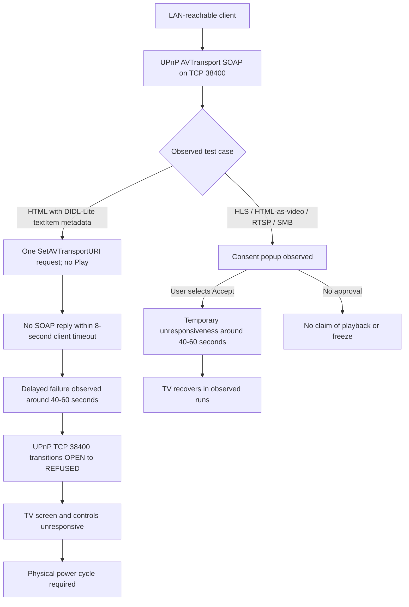

# Hisense VIDAA Smart TV — Unauthenticated UPnP AVTransport Denial of Service

> ** Security research advisory | Availability impact | LAN-adjacent attack surface | **

## Executive summary

Testing on a Hisense VIDAA Smart TV identified a **persistent device-wide denial-of-service condition associated with a single unauthenticated UPnP AVTransport `SetAVTransportURI` SOAP request** to TCP port **38400**. In isolated experiments using an HTML resource identified by DIDL-Lite `object.item.textItem` metadata, the request did not receive a SOAP response within the client's eight-second timeout. The TV subsequently became unresponsive approximately **40–60 seconds** after the request. The UPnP port transitioned from accepting TCP connections to refusing them, while three other monitored TV ports remained reachable. The screen, remote control, and physical power control were unresponsive; recovery required disconnecting and reconnecting mains power.

**Neither `Play` nor a request flood was necessary in these isolated tests.** Earlier flooding-related observations remain part of the research history, but the newer single-request evidence is the more precise reproduction finding. The exact native failure mechanism has not been determined.

A **separate observed behavior** affects other tested media URI formats: **HLS playlist**, **HTML declared as video**, **RTSP URL**, and **SMB URL**. These produced a consent/acceptance popup in testing. **After the user selected Accept**, the TV became temporarily unresponsive for approximately **40 seconds to one minute**, then recovered in the observed runs. These consent-dependent cases should **not** be conflated with the persistent, no-`Play` HTML `textItem` finding. Popup presentation and outcome may depend on device state.

## Tested environment

| Field | Value |
|---|---|
| Vendor / platform | Hisense / VIDAA |
| Physical TV model | 55A57EXVT |
| Tested firmware | V0000.01.00a.P0220 |
| Affected interface | UPnP/DLNA AVTransport SOAP control |
| TCP port | 38400 |
| SOAP action investigated | `urn:schemas-upnp-org:service:AVTransport:1#SetAVTransportURI` |
| Attack position | Network client with access to the TV's LAN-facing service |
| Research status | Reproduced on the specified device; native root cause and broader model exposure unverified |

> **Device identification note:** The UPnP device-description XML has also advertised a different model identifier (`55A6100FX`). The physical device model above is used for this report; the discrepancy has not been resolved and should not be treated as evidence that both models are affected.

## 01 — Findings and observed behavior

### 1.1 — Persistent denial of service: single `SetAVTransportURI` request

The TV's UPnP AVTransport endpoint accepted a network-originated SOAP request without an observed authentication or pairing challenge. The isolated `html-textitem` **`set-only`** test sent **one** `SetAVTransportURI` operation referring to an HTTP HTML resource described as a DIDL-Lite text item. No `Play`, `Stop`, retry, or cleanup action was sent by the isolated tester.

Observed results:

- The SOAP client timed out after approximately **8.025 seconds** without a complete response. **A client timeout is not, by itself, proof of DoS.**
- In two separate single-request trials, the TV froze after approximately **60 seconds** and **45 seconds**, respectively.
- In another trial, the first request did not cause an observed freeze during a two-minute wait; the TV froze approximately **45 seconds after a second request**. This variability suggests timing or state may influence the outcome; repeated requests are **not required** in all runs.
- During the freeze, the display and normal controls were unresponsive. The researcher reports that restoring operation required a physical mains power cycle.
- Network monitoring independently recorded the UPnP listener changing from `OPEN` to `REFUSED` while ports `4444`, `56789`, and `56790` continued accepting TCP connections. This supports a failure involving the UPnP service path, but does not prove that other services or the underlying operating system remained fully functional.

### 1.2 — Consent-dependent temporary unresponsiveness with other URI formats

The following media URI cases displayed an on-screen consent popup in the researcher's tests. **Selecting Accept** was followed by a temporary freeze lasting approximately **40–60 seconds**, after which the TV recovered in the observed runs.

| Tested media URI / declaration | Observed consent prompt | Observed behavior after Accept |
|---|---|---|
| HLS playlist (`.m3u8`) | Yes | Temporary unresponsiveness, approximately 40–60 seconds |
| HTML resource declared as video | Yes | Temporary unresponsiveness, approximately 40–60 seconds |
| RTSP URL | Yes | Temporary unresponsiveness, approximately 40–60 seconds |
| SMB URL | Yes | Temporary unresponsiveness, approximately 40–60 seconds |

**Evidence boundaries:** These are researcher-observed outcomes, not proof that the TV fetched or decoded the remote content. A popup is not evidence of a successful outbound media request. Earlier mixed-case tests also produced inconsistent popup/freeze behavior, so this table is not a claim of deterministic behavior on every attempt. The exact condition leading to temporary unresponsiveness has not been isolated.

## 02 — Updated attack and observation diagram



*This diagram summarizes externally observed sequences, **not** verified internal execution paths. The persistent HTML `textItem` and consent-dependent media-URI observations are separate behaviors.*

## 03 — Timestamped evidence from the isolated single-request experiment

The following times are in **UTC on 2026-10-31**. The tester and health monitor were run during the same isolated experiment.

| Time (UTC) | Event | Interpretation |
|---|---|---|
| 21:49:51–21:50:01 | UPnP TCP 38400 and three comparison ports report `OPEN` | Baseline TCP connectivity |
| 21:50:03.495 | Single `SetAVTransportURI` operation starts | No `Play` operation requested |
| 21:50:11.520 | Client reports `TimeoutError: timed out` after 8.025 seconds | SOAP response was not received within client deadline |
| 21:50:48.702 | UPnP TCP 38400 still `OPEN` | Listener still accepts TCP connections at this instant |
| 21:50:50.771 | UPnP TCP 38400 first reports `REFUSED` | Listener unavailable approximately 47.3 seconds after request start |
| 21:50:50–21:54:04 | UPnP remains `REFUSED`; comparison ports remain `OPEN` | Persistent loss of UPnP TCP availability during the recorded interval |

The researcher separately observed a TV freeze approximately **40 seconds** after the request. The exact onset of on-screen unresponsiveness was not captured by an automated screen-state sensor, so its timestamp is approximate.

**Important distinctions:**

- `TimeoutError` is a **client-side wait limit**, not an HTTP error returned by the TV and not evidence that the request was rejected.
- A TCP `OPEN` result indicates connection acceptance, **not** successful SOAP processing.
- TCP `REFUSED` establishes that new connections were rejected at the time of each probe; it does not identify whether a process crashed, a listener closed, or another internal condition occurred.
- ICMP was `NO_REPLY` even during the healthy baseline, so ICMP cannot be used to conclude that the TV's operating system failed.
- The packet capture supports transmission of the single SOAP request and absence of a timely successful SOAP response. No HTTP fetch to the researcher's media-server port `8765` was observed in that capture; the evidence does **not** establish an outbound HTML download or rendering event.

### Independent observations and repeatability

| Trial | Request sequence | Outcome |
|---|---|---|
| 1 | One `html-textitem` set-only request; waited 120 seconds; sent second request | Freeze approximately 45 seconds after second request |
| 2 | One `html-textitem` set-only request | Freeze approximately 60 seconds later |
| 3 | One `html-textitem` set-only request | Freeze approximately 45 seconds later |
| Timestamped isolated run | One `html-textitem` set-only request | SOAP timeout at 8.025 seconds; port 38400 refused new connections approximately 47 seconds after start; persistent refusal observed for more than three minutes |

The first three trials are researcher-reported timing observations. The timestamped run is supported by the recorded console output and health-monitor log. Additional independent device testing would be required to estimate reliability or generalize beyond this model and firmware.

## 04 — Security impact

**Availability:** A network-reachable, unauthenticated state-changing AVTransport operation was associated with a persistent, device-wide freeze requiring physical intervention to restore operation. No user approval was required in the isolated `html-textitem` `set-only` trials.

**Other media formats:** HLS, HTML-as-video, RTSP, and SMB testing produced consent prompts; accepting them was associated with **temporary**, self-recovering unresponsiveness. These observations do **not** demonstrate the same persistent failure or a consent bypass.

**Out of scope / not established:** No evidence here demonstrates code execution, credential theft, data exfiltration, persistence, exploitation across the internet, or susceptibility of other firmware versions. The native cause of the availability failure is unknown.

## 05 — Public proof of concept (illustrative, non-exploit)

To avoid distributing the complete denial-of-service trigger, the public README shows only the structure of a **benign UPnP SOAP request**. This example is **not** the freeze-inducing `textItem` payload, does not implement a flood, and should not be interpreted as a reproducible exploit.

```http
POST /upnp/control/mingusavtr HTTP/1.1
Host: TV_IP:38400
Content-Type: text/xml; charset="utf-8"
SOAPAction: "urn:schemas-upnp-org:service:AVTransport:1#GetTransportInfo"

<?xml version="1.0" encoding="utf-8"?>
<s:Envelope xmlns:s="http://schemas.xmlsoap.org/soap/envelope/">
  <s:Body>
    <u:GetTransportInfo xmlns:u="urn:schemas-upnp-org:service:AVTransport:1">
      <InstanceID>0</InstanceID>
    </u:GetTransportInfo>
  </s:Body>
</s:Envelope>
```

This example illustrates the SOAP envelope, action header, and control endpoint. It does not validate the DoS and is not guaranteed to be supported by every implementation. The detailed trigger, full scripts, and raw evidence can be shared privately with the vendor or a coordinating vulnerability authority under an appropriate disclosure process.

### Evidence from earlier callback research

The earlier AVTransport callback script exercised MP4, HTML, HLS, RTSP, and SMB cases. Its console output showed an eight-second `Play` timeout in one case and **no confirmed HTTP callbacks**. The researcher physically observed a complete freeze during that broader sequence, but the sequence could not uniquely attribute the failure to HLS or `Play` because earlier media operations had already been sent.


*Figure 1 — Earlier callback-test console output. This image documents command timing and timeouts; it does not independently document the physical freeze.*

## 06 — Root-cause assessment

The evidence currently supports a **delayed failure associated with processing an AVTransport `SetAVTransportURI` request containing HTML `textItem` metadata**. The delayed onset could reflect asynchronous work, an internal timeout, a state transition, or another implementation defect. The evidence **does not** prove a memory leak, deadlock, watchdog termination, malformed-media parsing defect, or lack of rate limiting.

Earlier research described the issue as **SOAP flooding**. The isolated single-request experiments show that high request volume is **not necessary** for the observed persistent failure. Accordingly, this advisory uses the more precise title **“Unauthenticated UPnP AVTransport Denial of Service”** rather than claiming flooding is the established cause.

Process logs, crash traces, or vendor firmware instrumentation would be needed to establish the exact native fault and the relationship, if any, between the persistent `textItem` condition and the temporary consent-dependent media-URI behavior.

## 07 — Recommended remediation

1. Require appropriate authorization or pairing before allowing untrusted LAN clients to change playback state.
2. Validate URI schemes, MIME types, and DIDL-Lite media classifications before invoking downstream media handlers.
3. Ensure `SetAVTransportURI` processing cannot block critical UI, control, or power-management paths; use bounded timeouts and safe cancellation.
4. Isolate media-control failures so a stalled or crashed component does not cause device-wide unresponsiveness.
5. Ensure consent prompts and user-approved playback requests fail safely when external resources are unavailable or unsupported.
6. Add regression tests for single-request delayed failure, repeated-request state transitions, and user-accepted HLS/HTML/RTSP/SMB playback attempts.
7. Limit exposure of the UPnP control service to trusted local network segments; add rate limits as defense in depth, not as an assumed root-cause fix.

**Temporary mitigation:** Prevent untrusted LAN devices from reaching the TV's UPnP control interface (TCP 38400), where network architecture permits, recognizing that doing so may disable legitimate media-control functionality.

## 08 — Disclosure and research limitations

This document describes testing on **one physically identified Hisense 55A57EXVT** running **V0000.01.00a.P0220**. Observations are based on researcher-operated laboratory tests, console output, packet captures, network health monitoring, and direct observation of TV behavior. No vendor-confirmed root cause or cross-model impact is asserted.

For coordinated remediation, the researcher can provide full reproduction artifacts and timestamped evidence privately to the vendor or vulnerability coordinator. The public version intentionally omits the full failure-inducing request and exploit automation.

---

*Responsible security disclosure — availability research on an authorized test device.*
