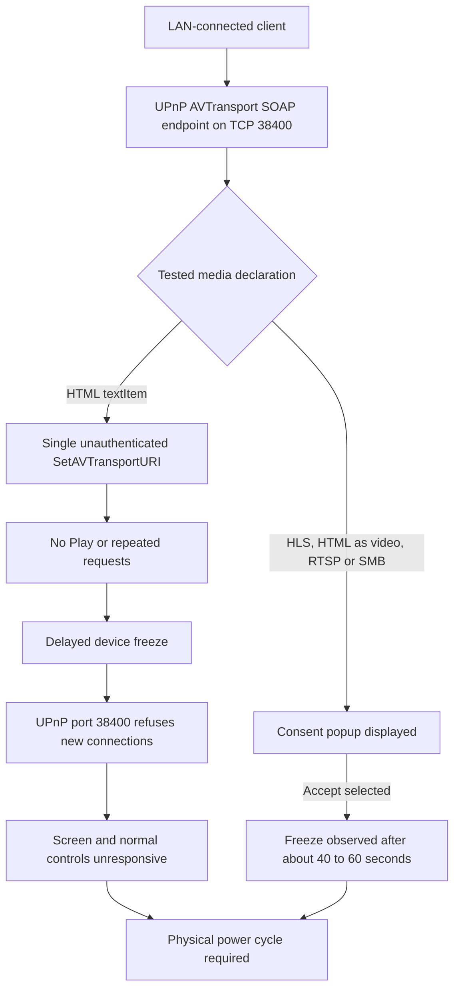

# Hisense VIDAA Smart TV — Unauthenticated UPnP AVTransport Denial of Service

> Security advisory | Availability impact | Local-network attack surface

## Executive summary

I identified and reproduced a **persistent denial-of-service vulnerability** affecting the UPnP/DLNA AVTransport service on my Hisense VIDAA Smart TV. A **single unauthenticated `SetAVTransportURI` SOAP request** containing an HTML resource described as a DIDL-Lite `object.item.textItem` was sufficient to cause a delayed device freeze. **No `Play` action, request repetition, or high-volume flooding was required.**

In my isolated tests, the television became unresponsive approximately **40–60 seconds** after the request. The displayed picture froze, the remote control and physical power button stopped responding, and I had to disconnect and reconnect mains power to restore normal operation.

I also observed problematic behavior when testing **HLS playlists, HTML resources declared as video, RTSP URLs, and SMB URLs**. These cases displayed an on-screen consent popup. After I selected **Accept**, the TV froze after approximately **40–60 seconds** and required a physical power restart in the observed cases documented here.

The exact internal cause has not been confirmed; I have not obtained firmware crash traces or process-level diagnostics.

## Tested environment

| Field | Value |
|---|---|
| Manufacturer / platform | Hisense / VIDAA |
| Physical TV model | 55A57EXVT |
| Firmware | V0000.01.00a.P0220 |
| Affected component | UPnP/DLNA AVTransport SOAP service |
| Service port | TCP 38400 |
| SOAP action | `urn:schemas-upnp-org:service:AVTransport:1#SetAVTransportURI` |
| Required access | Network reachability to the TV's UPnP service on the local network |
| Authentication / pairing | No authentication or pairing challenge observed for the tested request |

*The UPnP device-description XML advertised `55A6100FX`, which differs from the physical TV model. I have identified the tested hardware by its physical model number; I have not verified whether the other advertised model is affected.*

## 01 — Vulnerability description

The TV exposes a UPnP AVTransport SOAP control endpoint that accepts state-changing media commands from a LAN-reachable client without an observed authentication challenge.

I sent **one** `SetAVTransportURI` request specifying an HTTP HTML resource and DIDL-Lite metadata identifying that resource as `object.item.textItem`. The request was sent in **set-only** mode: the test did not issue `Play`, `Stop`, a retry, or any automatic cleanup operation.

The SOAP client did not receive a response within its eight-second deadline. The television subsequently froze, and its UPnP service stopped accepting new TCP connections. The screen and controls remained unresponsive until I physically power-cycled the device.

I reproduced the delayed freeze with a single request in separate isolated runs. The precise delay varied, but a second request was **not necessary** to reproduce the failure.

### Other tested media URI formats

I also tested additional URI formats. Each of the following displayed an on-screen consent popup. After I selected **Accept**, I observed a freeze approximately **40–60 seconds** later that required disconnecting and reconnecting power to recover.

| **Tested media URI / declaration** | **Observed consent prompt** | **Observed behavior after Accept** |
|---|---|---|
| HLS playlist (`.m3u8`) | Yes | TV froze after approximately 40–60 seconds; physical power restart required |
| HTML resource declared as video | Yes | TV froze after approximately 40–60 seconds; physical power restart required |
| RTSP URL | Yes | TV froze after approximately 40–60 seconds; physical power restart required |
| SMB URL | Yes | TV froze after approximately 40–60 seconds; physical power restart required |

These are separate observations from the **single-request HTML `textItem` finding**. The popup does not prove that the TV successfully downloaded, parsed, or played the remote resource. The observed behavior may vary with the TV's state.

## 02 — Attack and observation diagram



*The diagram represents the externally observed attack and device behavior. It is not a verified trace of the TV's internal implementation.*

## 03 — Technical evidence

### Isolated single-request experiment

I recorded the following events during an isolated run on **31 October 2026 (UTC)**:

| UTC timestamp | Observation |
|---|---|
| 21:49:51–21:50:01 | TCP 38400 and comparison ports 4444, 56789 and 56790 accepted connections |
| 21:50:03.495 | I initiated one `SetAVTransportURI` request with HTML `textItem` metadata |
| 21:50:11.520 | The SOAP client reached its eight-second response deadline without a response |
| 21:50:48.702 | TCP 38400 still accepted a connection |
| 21:50:50.771 | TCP 38400 began refusing new connections |
| Through 21:54:04 | TCP 38400 continued refusing connections; ports 4444, 56789 and 56790 continued accepting TCP connections |

The change from an accepting to a refusing UPnP TCP port occurred approximately **47 seconds after the request began**. The port remained unavailable for more than three minutes of monitoring. I also observed the TV screen and controls become unresponsive and required a physical power restart.

**Evidence scope:** TCP connectivity on the other ports establishes only that those ports accepted connections; it does not establish that their applications or the operating system were fully functional. The precise native failure mechanism remains unknown.

### Packet capture and monitoring

I captured the SOAP traffic and monitored the TV's service ports during the test. The capture documents the `SetAVTransportURI` request and the absence of a timely SOAP response. The independent health monitor records the subsequent loss of the UPnP listener. Together with my physical observations, these provide evidence of a delayed, persistent availability failure.

## 04 — Proof of concept (illustrative only)

The following **non-destructive format example** shows the general structure of a UPnP AVTransport SOAP envelope. It intentionally uses a benign placeholder URI and **does not include the freeze-triggering metadata, full exploit payload, or automation**.

```xml
POST /upnp/control/mingusavtr HTTP/1.1
Host: TV_IP:38400
Content-Type: text/xml; charset="utf-8"
SOAPAction: "urn:schemas-upnp-org:service:AVTransport:1#SetAVTransportURI"

<?xml version="1.0" encoding="utf-8"?>
<s:Envelope xmlns:s="http://schemas.xmlsoap.org/soap/envelope/">
  <s:Body>
    <u:SetAVTransportURI xmlns:u="urn:schemas-upnp-org:service:AVTransport:1">
      <InstanceID>0</InstanceID>
      <CurrentURI>http://example.invalid/sample.mp4</CurrentURI>
      <CurrentURIMetaData></CurrentURIMetaData>
    </u:SetAVTransportURI>
  </s:Body>
</s:Envelope>
```

This example is provided for protocol context only. It is **not** a reproduction of the denial-of-service condition. I am not publishing the complete trigger sequence or exploit code in this README.

## 05 — Security impact

- **Unauthenticated LAN-originated availability impact:** I did not need to pair with the TV or provide credentials to submit the tested SOAP request.
- **Persistent device freeze:** The screen, remote control, and physical power button became unresponsive.
- **Physical recovery required:** I had to disconnect and reconnect mains power to restore operation.
- **Delayed manifestation:** The failure appeared tens of seconds after a single request, rather than necessarily at the moment it was sent.
- **Service disruption:** The UPnP service on TCP 38400 stopped accepting connections for more than three minutes in the monitored run.

I did **not** demonstrate command execution, data exfiltration, privilege escalation, or persistence. I have verified the issue on the tested device and firmware only.

## 06 — Root cause assessment

I have confirmed the externally observable denial-of-service behavior, but I have **not** determined whether the internal failure is caused by a process crash, deadlock, media-state handling defect, timeout, watchdog action, or another implementation issue. A firmware-level investigation or vendor diagnostic logs would be needed to establish that mechanism.

## 07 — Recommended remediation

1. Require appropriate authorization or pairing before accepting state-changing AVTransport commands from LAN clients.
2. Validate media URIs, MIME types, DIDL-Lite metadata, and permitted media-type transitions before processing.
3. Handle unsupported or inconsistent media declarations safely, without blocking or terminating critical services.
4. Isolate media-control processing from UI, remote-control, and power-management functions.
5. Apply bounded execution time, safe cancellation, and recovery mechanisms for stalled media operations.
6. Add regression tests for single-request failures and consent-dependent playback paths, including delayed failure monitoring.
7. Where practical, restrict UPnP access to trusted network segments.

## 08 — Scope and responsible disclosure

I performed these tests on my own Hisense VIDAA television in a controlled local-network environment. The results apply to the tested model and firmware; I have not established exposure across other VIDAA versions or Hisense devices.

This public README intentionally omits the complete freeze-triggering payload and automated exploit implementation. Additional packet captures, timing records, and technical details can be provided to the vendor or an authorized vulnerability-coordination team for verification and remediation.
