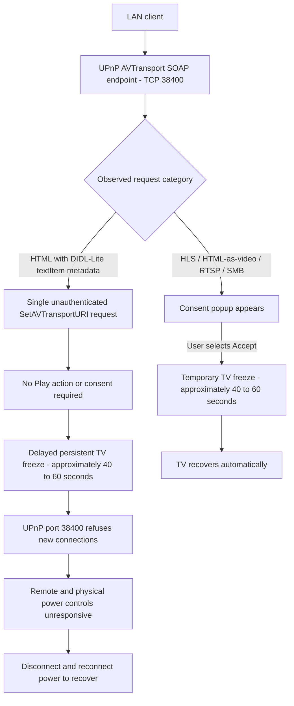

# Hisense VIDAA Smart TV - Unauthenticated UPnP AVTransport Denial of Service

> Security advisory | Availability impact | Local-network attack surface

## Executive summary

I identified an **unauthenticated denial-of-service vulnerability** in the UPnP/DLNA AVTransport service of my Hisense VIDAA Smart TV. A **single `SetAVTransportURI` SOAP request**, supplying an HTML resource identified in DIDL-Lite metadata as `object.item.textItem`, was sufficient to trigger a **delayed, persistent TV freeze** in my isolated tests. I did not need to send a `Play` request, flood the endpoint, or approve an on-screen prompt.

Approximately **40–60 seconds** after the request, the screen and device controls became unresponsive. The remote control and physical power button did not restore operation; I had to **disconnect and reconnect mains power**. In a timestamped test, the UPnP service on **TCP 38400** stopped accepting new connections approximately **47 seconds** after the request and remained unavailable for more than 30 minutes of monitoring.

I also observed a **separate, temporary playback-related freeze** with HLS playlists, HTML resources declared as video, RTSP URLs, and SMB URLs. Those cases displayed an on-screen consent popup. **After I selected Accept**, the TV froze for approximately **40–60 seconds and then recovered automatically**, without a power restart. These are distinct observations and should not be confused with the persistent `textItem` denial of service.

## Tested environment

| Field | Value |
|---|---|
| Vendor / platform | Hisense / VIDAA |
| Physical device model | 55A57EXVT |
| Firmware | V0000.01.00a.P0220 |
| Affected interface | UPnP/DLNA AVTransport SOAP control |
| Service port | TCP 38400 |
| Relevant SOAP action | `urn:schemas-upnp-org:service:AVTransport:1#SetAVTransportURI` |
| Attack position | A client able to access the TV's local-network service |

*Device-identification note:* The UPnP device description advertised `55A6100FX`, whereas the physical TV is labeled `55A57EXVT`. I have not verified that the advertised model is separately affected.

## 01 - Vulnerability description

### 1.1 - Persistent denial of service without user interaction

I tested the TV's unauthenticated AVTransport SOAP interface using **one `SetAVTransportURI` request** referencing an HTTP HTML resource with DIDL-Lite `object.item.textItem` metadata. I did **not** send a `Play` action as part of this isolated request.

The request did not receive a SOAP response within the test client's eight-second timeout. After a delay, I observed the following:

- The television's displayed content froze.
- The remote control and physical power button stopped responding.
- TCP port **38400** changed from accepting connections to refusing them.
- TCP ports **4444**, **56789**, and **56790** continued accepting connections during the monitored period.
- Normal operation could be restored only by physically disconnecting and reconnecting power.

The failure was reproduced with **a single request**. The delayed onset suggests that the visible failure does not necessarily coincide with the moment the SOAP request is sent. I have not established whether the internal cause is a crash, deadlock, watchdog action, or another implementation defect.

### 1.2 - Consent-dependent temporary freezes with other media formats

I separately tested several media URI formats. Each displayed a consent popup. **When I selected Accept, the TV froze for approximately 40 seconds to one minute, then returned to normal operation on its own.** A physical power restart was **not** required in these cases.

| Tested media URI / declaration | Consent popup | Behavior after I selected Accept |
|---|---|---|
| HLS playlist (`.m3u8`) | Yes | TV temporarily froze for approximately 40–60 seconds, then recovered automatically |
| HTML resource declared as video | Yes | TV temporarily froze for approximately 40–60 seconds, then recovered automatically |
| RTSP URL | Yes | TV temporarily froze for approximately 40–60 seconds, then recovered automatically |
| SMB URL | Yes | TV temporarily froze for approximately 40–60 seconds, then recovered automatically |

These results describe the behavior I observed during testing. The popup does not, by itself, establish that the TV downloaded or decoded the referenced resource. Unlike the persistent `textItem` case, these temporary freezes occurred **after user acceptance**.

## 02 - Attack and observation diagram



*The diagram shows externally observed behavior, not a verified internal call graph or firmware-level root cause.*

## 03 - Technical evidence

I collected packet captures and network health-monitor logs during an isolated single-request test on.

| Time (UTC) | Observation |
|---|---|
| 21:49:51–21:50:01 | TCP 38400 and three comparison ports accepted connections |
| 21:50:03.495 | I initiated one `SetAVTransportURI` request |
| 21:50:11.520 | The SOAP client reached its eight-second response deadline |
| 21:50:48.702 | TCP 38400 still accepted a connection |
| 21:50:50.771 | TCP 38400 first refused a new connection — approximately 47 seconds after request initiation |
| 21:50:50–21:54:04 | TCP 38400 continued refusing connections; the other three monitored ports continued accepting them |

I also physically observed the screen and controls become unresponsive around the time of the service failure. The exact onset of the screen freeze is approximate; the network timestamps are taken from the recorded monitoring output.

The packet capture documents the SOAP request and the absence of a timely SOAP response. The port observations independently establish loss of the UPnP listener's availability during the recorded period. These measurements do not identify the exact native fault or prove that the TV fetched the remote HTML resource.

## 04 - Security impact

**Persistent, unauthenticated denial of service:** A LAN-reachable client can cause a device-wide availability failure through a single state-changing UPnP AVTransport request in the tested environment. The persistent failure did not require user approval and required a physical power cycle to recover.

**Consent-dependent temporary disruption:** I also observed temporary TV freezes after accepting playback prompts for HLS, HTML-as-video, RTSP, and SMB URIs. In those cases the TV recovered automatically after approximately 40–60 seconds.

I have **not** demonstrated remote code execution, credential theft, data exfiltration, persistence, or that other TV models or firmware versions are affected.

## 05 - Proof of concept (illustrative)

The following example shows the **general structure** of a UPnP AVTransport SOAP message.

```http
POST /upnp/control/mingusavtr HTTP/1.1
Host: TV_IP:38400
Content-Type: text/xml; charset="utf-8"
SOAPAction: "urn:schemas-upnp-org:service:AVTransport:1#GetTransportInfo"

<?xml version="1.0" encoding="utf-8"?>
<s:Envelope xmlns:s="http://schemas.xmlsoap.org/soap/envelope/">
  <s:Body>
    <u:GetTransportInfo xmlns:u="urn:schemas-upnp-org:service:AVTransport:1">
      <InstanceID>0</InstanceID>
    </u:GetTransportInfo>
  </s:Body>
</s:Envelope>
```

This is a **non-exploit, illustrative request**; it does not reproduce the denial of service.

### Proof-of-concept console screenshot


*Figure 1 - Console output from my AVTransport testing. The screenshot documents the commands and response timing; I observed the TV's physical behavior separately.*

## 06 - Root-cause assessment

The evidence points to a delayed failure associated with the AVTransport processing path when a `SetAVTransportURI` request supplies HTML `textItem` metadata. The exact mechanism remains **unconfirmed**. Possible explanations include asynchronous processing failure, an internal timeout, or an invalid media-state transition, but I cannot distinguish these without process logs, crash traces, or firmware instrumentation.

The consent-dependent temporary freezes may involve a different failure path. I have not established that they share the same underlying defect as the persistent denial of service.

## 07 - Recommended remediation

1. Require appropriate authorization or pairing for state-changing AVTransport commands from untrusted LAN clients.
2. Validate URI schemes, MIME types, and DIDL-Lite media classifications before passing requests to media handlers.
3. Apply bounded timeouts, cancellation, and safe error handling to media-session operations.
4. Isolate media-control failures from the TV's user interface and power-management controls.
5. Ensure consent-based playback fails safely when a resource is unavailable or unsupported.
6. Regression-test single-request delayed failures and consent-dependent HLS, HTML, RTSP, and SMB playback behavior.
7. Restrict access to UPnP control services on untrusted network segments where feasible.

**Temporary mitigation:** Restrict untrusted local-network devices from reaching the TV's UPnP AVTransport service on TCP 38400, recognizing that this may affect legitimate media-control features.

## 08 - Scope and disclosure

I tested **one Hisense 55A57EXVT** running firmware **V0000.01.00a.P0220**. My findings are based on direct device observation, console output, packet captures, and TCP health-monitor logs. I have not confirmed the native root cause or assessed the impact on other models or firmware versions.

I am with holding the complete freeze-triggering payload and automation from this public README. Detailed reproduction evidence can be shared privately for coordinated remediation.

---

*Responsible security disclosure - testing performed on my own device.*
