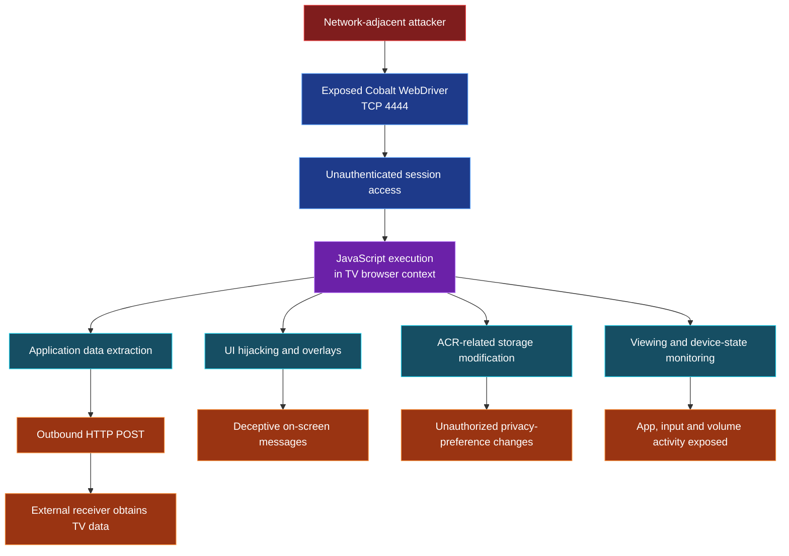

Unauthenticated WebDriver Access via QA Build in Production Firmware in Google Cobalt

**Security advisory | Yehia Elghaly | Coordinated disclosure**

> [!IMPORTANT]
> **CVE ID pending.** This document describes a vulnerability verified on one Hisense 55A57EXVT running firmware `V0000.01.00a.P0220`.

| Affected device | Exposed interface | Access required |
|---|---|---|
| Hisense 55A57EXVT (VIDAA) | Cobalt WebDriver, TCP `4444` | Network access to TV; **no authentication or pairing** |

**Observed browser build:** `19.lts.5.205289-qa`

## Vulnerability Overview

The tested smart television exposes a Google Cobalt WebDriver automation interface to the local network without authentication. A network-adjacent attacker can interact with an existing browser session and execute JavaScript in the TV's VIDAA user-interface context. The exposed automation capability permits unauthorized access to browser storage and UI state, modification of on-screen content, and transmission of accessible data to an external endpoint.

**Root cause:** A browser automation/debugging interface is reachable by untrusted network clients without an access-control boundary. The `-qa` build suffix is observable; the exact firmware packaging cause requires vendor confirmation.

## Demonstrated Security Impacts

### 01 - Unauthenticated Remote JavaScript Execution Leading to Sensitive Data Disclosure and External Exfiltration

**Attacker capability:** Any party able to reach the exposed WebDriver service can execute JavaScript inside the TV's active browser/UI session **without credentials, pairing, or approval from the TV owner**. Unlike harmless automation, this grants the remote party access to the application data and functions available to that browser context.

**Observed result:** I confirmed unauthenticated WebDriver session access and successfully executed arbitrary JavaScript within the Smart TV's browser context. I subsequently extracted internal localStorage data and demonstrated successful exfiltration to an external HTTP endpoint under my control.

The demonstrated impact includes unauthorized browser-context JavaScript execution, sensitive application data disclosure, and confirmed external data exfiltration. The findings do not establish operating-system-level remote code execution or unrestricted native code execution.

*Figure 1 & 2 - Unauthenticated WebDriver access and JavaScript execution in the television's UI context.*

### 02 - TV Interface Hijacking and Deceptive Full-Screen Overlays

**Attacker capability:** A network-adjacent attacker can replace or obscure the visible TV interface with attacker-controlled text and full-screen content. This could be used to **display fake security alerts, impersonate vendor warnings, mislead the viewer into following instructions, or disrupt normal TV use**. A deceptive overlay could facilitate social engineering; actual credential theft was not demonstrated.

**Observed result:** I successfully injected a full-screen warning overlay into the Smart TV's running user interface, which was visibly displayed on the physical television. This demonstrates unauthorized control over the content presented to the viewer.

*Figure 3 - Full-screen warning injected by the researcher, not a genuine Hisense security notice.*

### 03 - Unauthorized Modification of ACR and Advertising-Related Settings

**Attacker capability:** An attacker can **read and modify browser-stored privacy and advertising preferences** without the owner's consent. This creates an integrity risk: settings displayed or relied upon by the TV application may be tampered with, potentially misleading users about their privacy choices or altering application behavior where those settings are consumed.

**Observed result:** I have changed the `ACRSettingSwitch` from `1` to `0`, confirmed the modified value through an independent readback, and restored the original value. ACR, personalized-advertising, and recommendation-related keys were also accessible.

**Confirmed Security Impact:** I successfully modified the ACRSettingSwitch value from 1 to 0 through the unauthenticated WebDriver interface and verified the change. My testing also confirmed that the modification affected ACR functionality and bypassed the expected user consent notification, demonstrating unauthorized manipulation of privacy-related settings without the TV owner's knowledge or approval.

*Figure 4 5 & 6 - Unauthorized modification and verification of an ACR-related browser-storage value.*

### 04 - Viewing-Activity and Device-State Monitoring

**Attacker capability:** A remote attacker can observe browser-accessible app and input state, potentially **tracking when a household switches between streaming apps, Live TV, and HDMI inputs**, as well as changes in volume and UI navigation. Repeated polling can reveal usage patterns and periods of activity without accessing the television physically.

**Observed result:** Monitoring output recorded changes among Netflix, YouTube, launcher and Live TV/HDMI-related routes, along with volume-state changes.

**Evidence boundary:** App names and routes do not establish the exact movie, episode, broadcast program, or complete viewing history.

*Figure 7 & 8 - Repeated observations of app/UI transitions and device-state changes.*

### 05 - Sensitive Application Data Extraction and Confirmed External Exfiltration

**Attacker capability:** The unauthenticated JavaScript execution can be used to **collect internal TV configuration and identifiers and send them beyond the local network**. This changes the exposure from passive access to an actionable confidentiality compromise.

**Observed result:** The researcher extracted **42–43 `localStorage` entries** across test runs, including ACR and advertising preferences, location-setting data, HDMI state, MAC-address-formatted keys, and advertising-service version/signature metadata. A controlled Webhook.site receiver recorded an approximately **2.4 KB HTTP POST** containing structured device information and `localStorage` values.

**Attack sequence:** **LAN access → unauthenticated WebDriver session → browser-context JavaScript → application data collection → external HTTP POST.**

*Figure 9 - Received JSON containing extracted application storage values.*

**Evidence boundary:** Advertising-service signature fields are not independently verified as reusable authentication credentials. No claim is made here of Wi-Fi password theft, unrestricted filesystem access.

## Attack-Path Overview

The following diagram summarizes the demonstrated attack path and its security consequences on the tested Smart TV.

**Attack prerequisite:** Network access to the exposed WebDriver service; no authentication or pairing was required during testing.

**Scope:** The demonstrated execution occurs in the Cobalt browser context. Unrestricted operating-system command execution was not established.

## Remediation

- **Disable WebDriver and QA/debug automation interfaces in production firmware** unless strictly required.
- If diagnostic access is required, restrict its network exposure and enforce strong authentication, authorization, and user-approved pairing.
- Separate automation contexts from sensitive UI state and native TV interfaces; audit production build/release controls.

## Disclosure

**Researcher:** Yehia Elghaly  
**CVE:** `CVE-2026-XXXXX` 
**Research presentation:** *Pwned on the Couch: Hacking Smart TVs into Surveillance Devices* - Black Hat MEA 2026
